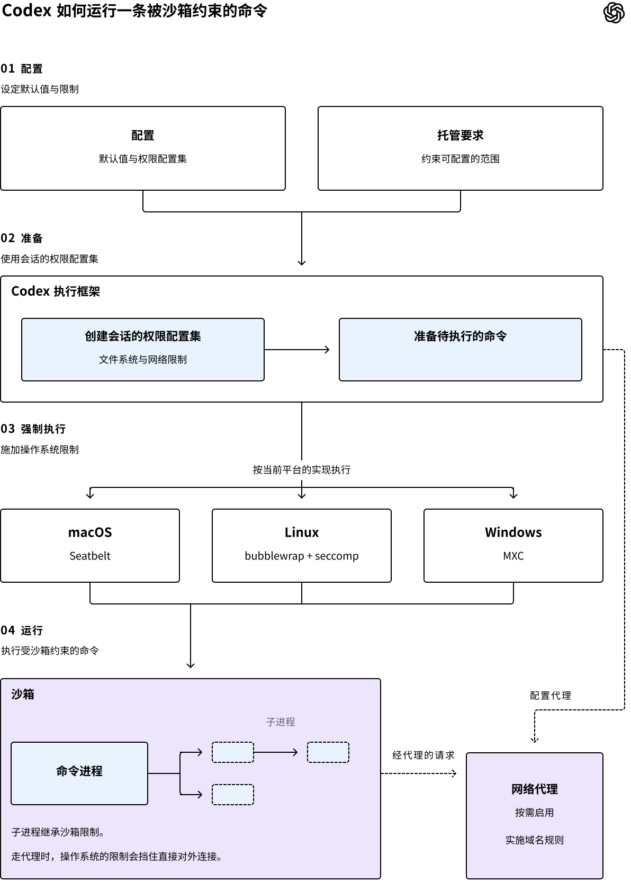
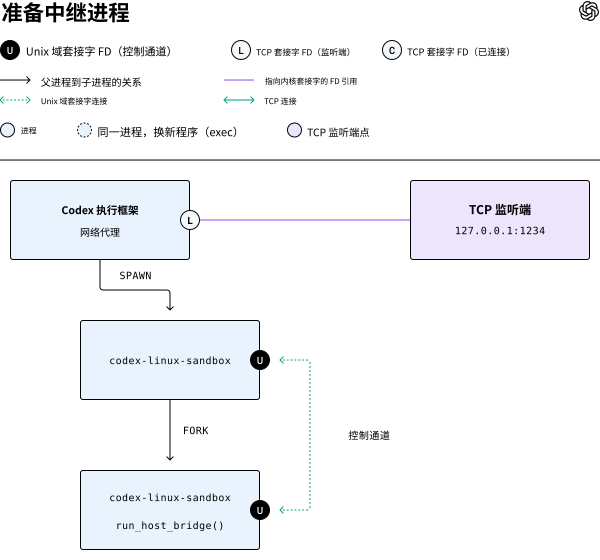
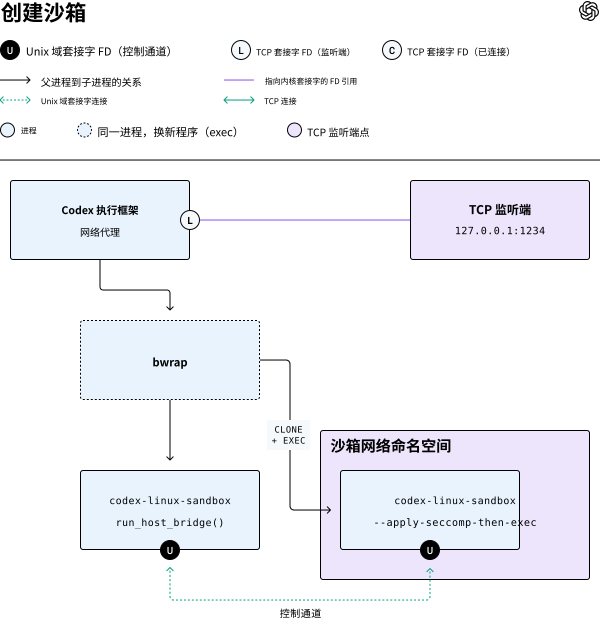
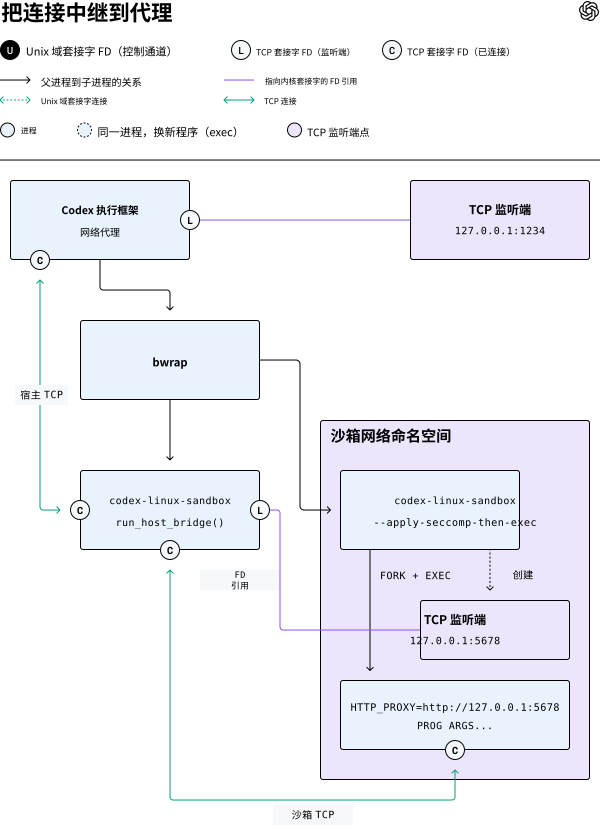

> [!NOTE]
> 本文是 OpenAI 官方博客 [Inside the Codex sandbox](https://openai.com/index/inside-the-codex-sandbox/) 的中文翻译，页面顶部可以在中文译文和英文原文之间切换，逐段对照。原文发布于 2026 年 11 月 18 日，按 OpenAI 统一署名，致谢名单里有 David Wiesen，Charlie Weems，Viyat Bhalodia 和 Fotis Chantzis。全文逐段译出，没有略去章节，术语做了中文化，原文里的外链都保留着。版权归原作者和 OpenAI 所有，译文只作学习交流之用。

> [!NOTE]
> 原文配图四张，都不带可见图注，描述写在图片的替代文本里。这里把四张图按原图重画成中文 SVG：方块位置，连线走向，虚线样式和配色都照原文，标签译成中文，`codex-linux-sandbox`，`run_host_bridge()`，`HTTP_PROXY=...` 这类标识符保留英文。图是透明底，不铺白框，深浅两种主题各用一套配色，暗色那套取自原站的暗色版本。图下那行中文小字是我加的，说明这张图该看哪里。文中带铅笔图标的注解同样是编者补充，不属于原文。

## 为什么值得读

OpenAI 很少把工程细节摊开到这种程度。这篇文章没有停在“我们做了沙箱”上，而是从一次命令调用出发，一路讲到系统调用：权限配置怎么描述，执行框架在哪个环节插入，操作系统拿什么机制强制执行，网络请求怎么绕到代理上。

它值得读的地方在于取舍写得很明白。为什么不用虚拟机或容器，为什么沙箱默认要保守，为什么网络要单独放一个代理，为什么 Linux 上要绕这么大一圈。这些不是抽象的原则，每一个都对应代码里的一处具体安排。

读的时候可以按图 1 的五个阶段走一遍：01 配置，02 准备，03 强制执行，04 运行，最后是按需接上的代理。后面几节基本就是这个顺序。


:::bi

At OpenAI, we take a [defense in depth](https://en.wikipedia.org/wiki/Defense_in_depth_(computing)) approach when it comes to safeguarding agents. While our investments in training and alignment are fundamental to this effort, we also implement features in our agentic harness, [Codex](https://github.com/openai/codex), to provide additional protections. Because one of the most common (and potentially risky) things Codex does is run commands on your computer, we built the *Codex sandbox* so Codex can work in your existing environment within filesystem and network limits you control.

:::zh

在 OpenAI，我们用[纵深防御](https://en.wikipedia.org/wiki/Defense_in_depth_(computing))的思路保护智能体。训练和对齐方面的投入是这项工作的基础，除此之外，我们也在智能体执行框架 [Codex](https://github.com/openai/codex) 里实现了相关功能，作为额外的保护。Codex 最常做（也最容易带来风险）的事情之一，就是在你的计算机上运行命令。因此我们构建了 *Codex 沙箱*，让 Codex 能在你现有的环境中工作，同时受到你掌控的文件系统和网络限制的约束。
:::

:::bi

A [*sandbox*](https://en.wikipedia.org/wiki/Sandbox_(computer_security)) limits what a program can access while it runs. For a photo-organizing task, you might configure the Codex sandbox to let commands read and modify files in `~/Pictures` while blocking network access to prevent uploads. For code review, you might allow access to online documentation while keeping source files read-only. Users configure the Codex sandbox through [*permission profiles*](https://learn.chatgpt.com/docs/permissions), which define the filesystem and network restrictions for a Codex session.

:::zh

[*沙箱*](https://en.wikipedia.org/wiki/Sandbox_(computer_security))限制程序运行时能访问哪些资源。以照片整理任务为例，你可以把 Codex 沙箱配置成允许命令读取和修改 `~/Pictures` 里的文件，同时切断网络访问，防止文件被上传。做代码审查时，你可以允许访问在线文档，同时把源文件保持为只读。用户通过[*权限配置集*](https://learn.chatgpt.com/docs/permissions)来配置 Codex 沙箱，权限配置集定义了 Codex 会话的文件系统和网络限制。
:::

:::bi

In this article, we’ll start with the tradeoffs behind Codex’s sandbox defaults, then explain the sandbox’s design and how the harness uses it to run commands. We’ll show how end users and enterprises can tailor its permissions to their needs and how developers can reuse the sandbox in their own tools. Finally, we’ll examine how these restrictions are enforced on macOS, Linux, and Windows.

:::zh

本文先讲 Codex 沙箱默认设置背后的取舍，再说明沙箱的设计，以及执行框架如何借助它运行命令。然后我们会展示最终用户和企业如何按需调整权限，开发者如何在自己的工具里复用沙箱。最后，我们来看 macOS，Linux 和 Windows 各自如何强制执行这些限制。
:::

## 确定沙箱边界（Choosing the sandbox boundaries）

:::bi

In Codex, our philosophy is to specify conservative defaults for the sandbox that still enable meaningful work. For example, with a Git repository as the workspace root, the built-in `:workspace` permission profile:

:::zh

在 Codex 里，我们的原则是给沙箱设置保守的默认值，同时保证它仍然能完成有意义的工作。例如，当工作空间根目录是一个 Git 仓库时，内置的 `:workspace` 权限配置集会：
:::

:::bi

- **Allows writes within the workspace, while keeping directories such as `.git` and `.codex` read-only.** This lets Codex edit source code without seeking permission for every change, while preventing direct changes to `.codex/config.toml` or Git hooks under `.git/hooks`.
- **Allows broad filesystem reads, subject to the user’s existing OS permissions.** Compilers, runtimes, and build tools depend on SDKs, libraries, and configuration outside the repository. Restricting reads to the workspace would break many ordinary workflows. The tradeoff is that sensitive files elsewhere on the machine may also remain readable (such as config files containing API keys).
- **Disables network access.** This blocks direct uploads to external services, including attempts to exfiltrate data the command can read. It also prevents legitimate operations such as downloading dependencies, which require additional access.

:::zh

- **允许在工作空间内写入，同时把 `.git` 和 `.codex` 这类目录保持为只读。**这样 Codex 编辑源代码时不用为每次改动都申请许可，也无法直接修改 `.codex/config.toml` 和 `.git/hooks` 下的 Git 钩子。
- **允许广泛读取文件系统，但仍受用户现有操作系统权限的限制。**编译器，运行时和构建工具依赖仓库之外的 SDK，库和配置文件。如果把读取范围限制在工作空间里，很多常规工作流就无法正常工作。代价是机器上其他位置的敏感文件也可能仍然可读，比如包含 API 密钥的配置文件。
- **禁用网络访问。**这会阻止命令直接向外部服务上传内容，包括试图把命令能读到的数据外泄出去。它也会阻止下载依赖这类正常操作，这些操作需要额外的访问权限。
:::

:::bi

These restrictions prevent a large class of bad behavior, but harmful actions are still possible. For example, the agent could inject malicious code into a locally installed package such as `node_modules/prettier`. Such a change might not appear in `git status` because `node_modules` is often ignored by Git. If the user’s editor runs that copy of Prettier on save, simply saving a file could execute the malicious code outside the Codex sandbox. This is why we take a defense in depth approach: the sandbox limits what commands can access, while training and alignment help the model use that access in accordance with the user’s intent.

:::zh

这些限制能挡住一大类不良行为，但有害操作仍然可能发生。例如，智能体可以向本地安装的软件包注入恶意代码，比如 `node_modules/prettier`。这种改动可能不会出现在 `git status` 里，因为 Git 通常忽略 `node_modules`。如果用户的编辑器在保存时运行这个 Prettier 副本，那么仅仅保存一个文件，就可能在 Codex 沙箱之外执行恶意代码。这正是我们采用纵深防御的原因：沙箱限制命令能访问什么，训练和对齐则帮助模型按用户的意图去使用这些访问权限。
:::

:::annotation
沙箱和训练对齐是两层防护，方向不一样：沙箱管“命令能碰到什么”，训练对齐管“模型会不会去做”。这一节举的 `node_modules/prettier` 例子值得留意，它说明沙箱挡住的是访问范围，挡不住“把东西塞进你信任的工具链”这类间接路径。
:::

:::bi

For guidance on tailoring sandbox permissions and combining them with other protections in an enterprise environment, see the [Codex security cookbook](https://learn.chatgpt.com/docs/enterprise/security-cookbook).

:::zh

关于如何调整沙箱权限，以及如何在企业环境里把它和其他防护措施配合使用，请参阅 [Codex 安全实用指南](https://learn.chatgpt.com/docs/enterprise/security-cookbook)。
:::

## 沙箱设计（Designing the sandbox）

:::bi

Virtual machines and [containers](https://opencontainers.org/) are two popular mechanisms used for sandboxing, but we take a different approach with the Codex sandbox. Instead of moving computation to a separate environment to provide isolation, Codex uses each platform’s sandboxing facilities to constrain commands running in the user’s existing environment.

For many developers, their laptop serves as a bespoke dev environment that they can change on a whim. Reproducing that environment in a Docker container can take work, and some workflows still depend on tools that run on the host.

:::zh

虚拟机和[容器](https://opencontainers.org/)是两种常用的沙箱机制，但 Codex 沙箱走的是另一条路。Codex 不把计算搬到独立环境里做隔离，而是利用各平台自带的沙箱能力，约束运行在用户现有环境中的命令。

对很多开发者来说，自己的笔记本电脑就是量身定做的开发环境，可以随时按需调整。把它复刻进 Docker 容器要花不少功夫，而且有些工作流仍然依赖跑在主机上的工具。
:::

:::bi

For example, consider using Codex to develop an iOS app on a Mac. If you decided to sandbox Codex by running it inside Docker, Codex would not be able to run the iOS build toolchain composed of native Mac executables, nor could it launch the iPhone simulator to run the code. A Docker-based workflow could delegate builds and simulator operations to the Mac host, but those operations would execute outside the container’s sandbox and would need their own restrictions. For Codex, we prefer to keep things simple by investing heavily in OS-specific sandboxing so Codex can run in the environment that is most appropriate to the task at hand.

:::zh

举个例子：设想在 Mac 上用 Codex 开发 iOS 应用。如果你为了给 Codex 加沙箱而把它放进 Docker 里跑，它就既无法运行由 Mac 原生可执行文件组成的 iOS 构建工具链，也无法启动 iPhone 模拟器来运行代码。基于 Docker 的工作流可以把构建和模拟器操作交给 Mac 主机，但这些操作会在容器沙箱之外执行，需要单独加限制。对 Codex 来说，我们更愿意把事情做简单：把资源集中投入到各操作系统的沙箱机制上，让 Codex 能在最适合当前任务的环境里运行。
:::

:::bi

The harness exposes these OS-specific sandboxing mechanisms through a common API across macOS, Windows, and Linux. This API takes a command and a permission profile. If the permission profile allows limited network access, the caller must supply a network proxy to enforce those limits:

:::zh

执行框架用一套统一的 API，把 macOS，Linux 和 Windows 各自的沙箱机制暴露出来。这个 API 接收一条命令和一个权限配置集。如果权限配置集允许有限的网络访问，调用方必须提供一个网络代理来实施这些限制：
:::

```python
# This is a simplified version of the actual API.
def spawn_command_under_sandbox(
    program_and_args: list[str],
    cwd: Path,
    env: dict[str, str],
    permission_profile: PermissionProfile,
    network_proxy: NetworkProxy | None,
) -> Child:
```

:::bi

This function starts the process in a sandbox and returns a `Child` handle the harness can use to wait for it to finish. Each child process inherits its parent’s sandbox constraints, so those restrictions apply throughout the process tree initiated by the command, even to descendants that outlive the original process.

:::zh

这个函数在沙箱里启动进程，返回一个 `Child` 句柄，执行框架可以用它等待进程结束。每个子进程都会继承父进程的沙箱约束，所以这些限制会作用于命令启动的整棵进程树，包括在原进程退出之后仍在运行的后代进程。
:::

:::bi

The following diagram shows how these pieces fit together, from configuration to running a sandboxed command. The sections that follow explain each stage.

:::zh

下图展示了从配置到运行沙箱命令的各个环节如何拼在一起，后面几节会逐一说明每个阶段。
:::

:::figure


Flow diagram: configuration and managed requirements define a session permission profile; the Codex harness launches commands under platform-specific sandbox restrictions on macOS, Linux, or Windows. Child processes inherit those restrictions, and an optional network proxy enforces domain rules.

:::zh
图 1：从配置到执行，一条命令要走过五道工序。先看 02 那层，配置和托管要求一起决定这次会话的权限配置集。再看 03 那三个平台方块，同一份配置集在 macOS 落到 Seatbelt，在 Linux 落到 bubblewrap 加 seccomp，在 Windows 落到 MXC。最后看 04 的紫色沙箱，子进程继承限制，右侧虚线接到网络代理，只有被允许的域名才出得去。
:::
:::

## 执行框架如何利用沙箱（How the harness leverages the sandbox）

:::bi

As explained in [Unrolling the Codex Agent Loop](/index/unrolling-the-codex-agent-loop/), the Codex harness is responsible for executing tool calls generated by the model. For coding tasks, the most commonly used tool is a *shell tool*, which runs commands much as a user would in an interactive shell such as Bash. Here we’ll examine the [one-shot `exec_command` shell tool](https://github.com/openai/codex/blob/60947e234156ac12bdb7fba2477d3965f166bd34/codex-rs/core/src/tools/handlers/unified_exec/exec_command.rs#L483-L512) to illustrate how the harness employs the sandbox to achieve the desired protections.

This is a simplified version of how the `exec_command` tool call would be honored by the Codex harness *without sandboxing*:

:::zh

如[《解析 Codex 智能体循环》](/index/unrolling-the-codex-agent-loop/)一文所述，Codex 执行框架负责执行模型生成的工具调用。在编程任务里，最常用的是 *shell 工具*，它执行命令的方式和用户在 Bash 这类交互式 shell 里差不多。下面我们以[单次执行的 `exec_command` shell 工具](https://github.com/openai/codex/blob/60947e234156ac12bdb7fba2477d3965f166bd34/codex-rs/core/src/tools/handlers/unified_exec/exec_command.rs#L483-L512)为例，说明执行框架如何借助沙箱实现预期的保护。

下面是 Codex 执行框架在*不加沙箱*时处理 `exec_command` 工具调用的简化版本：
:::

```python
# Illustrative implementation of the exec_command tool call.

class ExecCommandToolCall:
    cmd: str
    workdir: str | None = None
    shell: str | None = None
    login: bool = True
    timeout_ms: int = 10_000


def perform_exec_command(tool_call: ExecCommandToolCall):
    program_and_args = [
        tool_call.shell or os.environ.get("SHELL") or "/bin/sh",
        "-lc" if tool_call.login else "-c",
        tool_call.cmd,
    ]
    child = subprocess.Popen(
        program_and_args,
        # workdir defaults to the turn's cwd, assumed here to be the process cwd.
        cwd=Path(tool_call.workdir or ".").absolute(),
        stdout=subprocess.PIPE,
        stderr=subprocess.STDOUT,
    )
    output, exit_code = collect_output(child, timeout_ms=tool_call.timeout_ms)
    return {"output": output, "exit_code": exit_code}
```

:::bi

To sandbox the command, the harness replaces the call to `subprocess.Popen()` with `spawn_command_under_sandbox()`. The harness supplies the permission profile and, when needed, the network proxy:

:::zh

为了让命令在沙箱里运行，执行框架会把对 `subprocess.Popen()` 的调用换成 `spawn_command_under_sandbox()`。执行框架负责传入权限配置集，需要时再传入网络代理：
:::

```python
# Honoring the exec_command tool call while enforcing sandbox constraints.

def perform_exec_command_with_sandboxing(
    tool_call: ExecCommandToolCall,
    permission_profile: PermissionProfile,
    network_proxy: NetworkProxy | None,
):
    # ...build program_and_args as in the previous example...
    child = spawn_command_under_sandbox(
        program_and_args=program_and_args,
        cwd=Path(tool_call.workdir or ".").absolute(),
        env=os.environ.copy(),
        permission_profile=permission_profile,
        network_proxy=network_proxy,
    )
    output, exit_code = collect_output(child, timeout_ms=tool_call.timeout_ms)
    return {"output": output, "exit_code": exit_code}
```

:::bi

The `exec_command` tool also lets the model request different permissions for an individual command, but the harness decides whether to grant the request:

:::zh

`exec_command` 工具还允许模型为单条命令申请不同的权限，但批准与否由执行框架决定：
:::

```python
class ExecCommandToolCall:
    # ...command-related fields...

    # Per-command sandbox override. Defaults to "use_default".
    sandbox_permissions: Literal[
        "use_default",
        "with_additional_permissions",
        "require_escalated",
    ] = "use_default"

    # User-facing approval question; only for "require_escalated".
    justification: str | None = None

    # Expand network or filesystem access; only for "with_additional_permissions".
    # AdditionalPermissions supports fine-grained options.
    additional_permissions: AdditionalPermissions | None = None
```

:::bi

When `use_default` is specified, the harness uses the default sandbox config for the turn. `with_additional_permissions` requests expanded access within the sandbox, while `require_escalated` requests execution outside it. The harness evaluates the request based on the user’s preferences before executing the command. (For example, Codex may prompt the user directly, or it might route the request to [auto-review](https://learn.chatgpt.com/docs/sandboxing/auto-review).) If execution is authorized, Codex will pass the appropriate `permission_profile` and `network_proxy` to `perform_exec_command_with_sandboxing()` with the command arguments from the original `ExecCommandToolCall`.

:::zh

指定 `use_default` 时，执行框架使用当前轮次的默认沙箱配置。`with_additional_permissions` 请求扩大沙箱内的访问范围，`require_escalated` 请求到沙箱外执行。执行框架会在执行命令前，根据用户的偏好评估这个请求。（例如，Codex 可能直接询问用户，也可能把请求交给[自动审核](https://learn.chatgpt.com/docs/sandboxing/auto-review)。）如果执行获得授权，Codex 会把相应的 `permission_profile` 和 `network_proxy`，连同原始 `ExecCommandToolCall` 里的命令参数，一起传给 `perform_exec_command_with_sandboxing()`。
:::

:::bi

The shell tool is the primary consumer of `spawn_command_under_sandbox()`, and the harness also reuses its sandboxing infrastructure for operations such as reading and modifying local files. This reuse extends beyond the harness: the `codex sandbox` command lets you incorporate sandboxed command execution into your own tools, as we’ll see later. Next, we’ll look at how permission profiles are defined.

:::zh

shell 工具是 `spawn_command_under_sandbox()` 的主要调用方，执行框架也会复用同一套沙箱基础设施来处理读取和修改本地文件等操作。这种复用不止于执行框架：`codex sandbox` 命令能让你把沙箱化的命令执行接入自己的工具，后文会细说。接下来，我们看看权限配置集是怎么定义的。
:::

## 配置沙箱（Configuring the sandbox）

:::bi

A named permission profile lets you reuse the same filesystem and network restrictions across projects. You can define your own profiles under `[permissions]` in `config.toml`. For example, the following defines a profile named `dev` that [extends](https://learn.chatgpt.com/docs/permissions#extend-a-profile) the built-in `:workspace` profile:

:::zh

给权限配置集起个名字，同一套文件系统和网络限制就能跨项目复用。你可以在 `config.toml` 的 `[permissions]` 下定义自己的配置集。例如，下面这段配置定义了一个名为 `dev` 的配置集，它[扩展](https://learn.chatgpt.com/docs/permissions#extend-a-profile)了内置的 `:workspace` 配置集：
:::

```toml
# Use the dev profile by default.
default_permissions = "dev"

[permissions.dev]
# This is displayed when /permissions is run in the Codex CLI.
description = "Development with extra read-only protections."

# A profile can be derived from an existing profile.
# Profiles starting with ":" are provided by Codex.
extends = ":workspace"

[permissions.dev.filesystem]
"~/build-cache" = "write"

[permissions.dev.filesystem.":workspace_roots"]
".devcontainer" = "read"
".vscode" = "read"
"**/*.env" = "deny"
"secrets" = "deny"
```

:::bi

The `dev` profile adds write access to `~/build-cache` and places additional restrictions on files in the workspace. Filesystem entries can grant read-only access (`read`), grant read and write access (`write`), or block access entirely (`deny`).

:::zh

`dev` 配置集增加了对 `~/build-cache` 的写入权限，也对工作空间里的文件加了额外限制。文件系统条目可以授予只读权限（`read`），授予读写权限（`write`），或者完全禁止访问（`deny`）。
:::

:::bi

The `:workspace_roots` table lets you define rules for paths relative to a project’s workspace roots. By default, the Codex CLI uses its working directory as its sole workspace root, while the ChatGPT desktop app uses the project’s source folders. Codex applies each rule to every root, so the `.vscode` entry in `dev` makes the `.vscode` directory read-only under each root.

:::zh

`:workspace_roots` 表让你可以针对相对于项目工作空间根目录的路径定义规则。默认情况下，Codex CLI 把工作目录当作唯一的工作空间根目录，ChatGPT 桌面应用则使用项目的源代码文件夹。Codex 会把每条规则应用到所有根目录，所以 `dev` 里的 `.vscode` 条目会让每个根目录下的 `.vscode` 目录都变成只读。
:::

:::bi

In addition to its own rules, `dev` inherits the following protections from `:workspace`:

:::zh

除了自己的规则，`dev` 还从 `:workspace` 继承了下面这些保护：
:::

```toml
[permissions.":workspace".filesystem.":workspace_roots"]
".agents" = "read"
".aws" = "read"
".codex" = "read"
".git" = "read"
```

### 网络权限（Network permissions）

:::bi

When it comes to configuring the network for the sandbox in Codex, there are roughly three options:

:::zh

在 Codex 里配置沙箱的网络，大致有三种选择：
:::

:::bi

- Disable all network access (default for the `:workspace` profile)
- Enable full, direct network access (default for the `:danger-full-access` profile)
- Restrict network access to a proxy, which decides what to let through based on the permission profile

:::zh

- 禁用所有网络访问（`:workspace` 配置集的默认设置）
- 启用完整的直接网络访问（`:danger-full-access` 配置集的默认设置）
- 把网络访问限制到代理，由代理根据权限配置集决定放行哪些请求
:::

:::bi

To give `dev` direct network access, set `permissions.dev.network.enabled = true` at the top level of `config.toml`. This grants full network access when the network proxy is disabled.

:::zh

要让 `dev` 直接访问网络，在 `config.toml` 的顶层设置 `permissions.dev.network.enabled = true`。在网络代理关闭时，这会授予完整的网络访问权限。
:::

:::bi

To restrict `dev` to a set of domains, enable the network proxy and configure its domain rules:

:::zh

要把 `dev` 的网络访问限制在一组域名内，就启用网络代理并配置它的域名规则：
:::

```toml
[permissions.dev.network]
enabled = true

[permissions.dev.network.domains]
"*.openai.com" = "allow"
# Allow requests to local services by hostname or by IPv4/IPv6 loopback address.
"localhost" = "allow"
"127.0.0.1" = "allow"
"::1" = "allow"
"evil.example" = "deny"

[features]
# If neither local config nor managed requirements enable the proxy,
# this profile allows direct network access; domain rules are not enforced.
network_proxy = true
```

:::bi

Domain rules support exact names and wildcard patterns, with explicit deny rules taking precedence over allow rules. Requests to other domains require approval or are blocked, as described in Network proxy below.

:::zh

域名规则支持精确名称和通配符模式，显式的拒绝规则优先于允许规则。对其他域名的请求需要批准，否则会被阻止，详见下文的网络代理一节。
:::

### 分层配置与强制限制（Layering configuration and enforcing limits）

:::bi

Individual users can configure defaults that apply across projects and override them for a particular trusted project. Enterprise administrators may also want to configure defaults for their users and constrain which settings those users can change. Codex supports both through layered configuration and managed requirements.

:::zh

个人用户可以配置对所有项目生效的默认值，再针对某个受信任的项目覆盖这些默认值。企业管理员可能也想为用户配置默认值，并限制用户能改哪些设置。Codex 通过分层配置和托管要求同时支持这两类需求。
:::

:::bi

As described in [Configuration precedence,](https://learn.chatgpt.com/docs/config-file/config-basic#configuration-precedence) Codex merges settings from multiple `config.toml` files. Tables are merged recursively, with the higher-precedence source winning when values conflict. Arrays are replaced as a whole.

:::zh

如[配置优先级](https://learn.chatgpt.com/docs/config-file/config-basic#configuration-precedence)所述，Codex 会合并多个 `config.toml` 文件里的设置。表会递归合并，值冲突时以优先级更高的来源为准。数组则整体替换。
:::

:::bi

This is why permission profiles use tables for filesystem paths and network domains. A team can add or override individual entries in its own configuration and automatically inherit changes to all other entries in the organization’s base configuration:

:::zh

这就是权限配置集用表来表示文件系统路径和网络域名的原因。团队可以在自己的配置里添加或覆盖个别条目，同时自动继承组织基础配置中其他条目的改动：
:::

```toml
[permissions.dev.filesystem.":workspace_roots"]
".idea" = "read"

[permissions.dev.network.domains]
"example.com" = "allow"
```

:::bi

Administrators can also supply [managed requirements](https://learn.chatgpt.com/docs/enterprise/managed-configuration) through `requirements.toml` to constrain users’ configuration choices. These requirements can come from multiple sources, including system files and cloud-provided policy. A common use case is to specify `allowed_permission_profiles` to constrain the set of permission profiles an enterprise user can select. For example, an administrator could specify these cloud requirements:

:::zh

管理员还可以通过 `requirements.toml` 提供[托管要求](https://learn.chatgpt.com/docs/enterprise/managed-configuration)，限制用户能做的配置选择。这些要求可以有多个来源，包括系统文件和云端下发的策略。一种常见用法是指定 `allowed_permission_profiles`，限制企业用户可选的权限配置集范围。例如，管理员可以指定这样一组云端要求：
:::

```toml
default_permissions = ":read-only"

[allowed_permission_profiles]
":read-only" = true
":danger-full-access" = false
```

:::bi

The cloud requirements would take precedence over the system requirements file at `/etc/codex/requirements.toml`, so an entry in that file cannot override the explicit `":danger-full-access" = false` above. Leaving `:workspace` unspecified allows another requirements layer to supply that entry. Profiles whose entries are `false` or absent from the final merged table are unavailable.

This separation lets organizations enforce limits while users tailor their configuration within those limits. The resulting permission profiles can be used by the harness or applied directly to a command, as we’ll see next.

:::zh

云端要求的优先级高于系统要求文件 `/etc/codex/requirements.toml`，所以该文件里的条目无法覆盖上面显式写出的 `":danger-full-access" = false`。不指定 `:workspace`，就留给其他要求层来提供这个条目。最终合并后的表里，条目为 `false` 或者根本没有对应条目的配置集都不可用。

这种分工让组织能强制执行限制，用户则可以在限制范围内调整自己的配置。合并出来的权限配置集既可以交给执行框架使用，也可以直接应用到一条命令上，下一节就来看这一点。
:::

## 使用 `codex sandbox` 命令（Using the codex sandbox command）

:::bi

The Codex CLI provides a `sandbox` command to facilitate running an arbitrary command under a permission profile defined in the Codex config. This is commonly used to test out the profile, ensuring that the sandbox prevents the behavior it was designed to block.

:::zh

Codex CLI 提供了 `sandbox` 命令，方便你在 Codex 配置中定义的权限配置集下运行任意命令。一个常见用途是测试配置集，确认沙箱能阻止它本该阻止的行为。
:::

:::bi

For example, the following command attempts to configure VS Code to run a malicious auto-formatter on save. Assuming `.vscode` already exists, the `dev` profile defined above should block this write because that directory is read-only (`codex sandbox` treats `cwd` as a workspace root by default):

:::zh

例如，下面这条命令试图把 VS Code 配置成在保存时运行一个恶意的自动格式化程序。假设 `.vscode` 已经存在，上面定义的 `dev` 配置集应该会阻止这次写入，因为这个目录是只读的（`codex sandbox` 默认把 `cwd` 当作工作空间根目录）：
:::

```bash
codex sandbox --permission-profile dev -- \
  bash -c 'cat > .vscode/settings.json' <<'JSON'
{
  "prettier.prettierPath": "./node_modules/evil-prettier",
  "[typescript]": {
    "editor.defaultFormatter": "esbenp.prettier-vscode",
    "editor.formatOnSave": true
  }
}
JSON
```

:::bi

Indeed, on macOS this fails with:

:::zh

在 macOS 上运行，这条命令确实会失败，输出如下：
:::

```text
bash: .vscode/settings.json: Operation not permitted
```

:::bi

The `codex sandbox` command makes Codex’s sandboxing mechanism available independently of an agent session. You can use the same configuration language and platform-specific enforcement to constrain commands launched by your own tools.

:::zh

`codex sandbox` 命令让 Codex 的沙箱机制可以脱离智能体会话单独使用。你可以用同一套配置语言和各平台专属的强制实施机制，约束自己的工具启动的命令。
:::

### 示例：沙箱化 MCP 服务器（Example: sandboxing an MCP server）

:::bi

For a stdio MCP server configured in `config.toml`, the Codex harness does not attempt to sandbox the command used to start the server. Codex cannot reliably infer which files or network services that server needs, so applying a default sandbox profile could break an otherwise valid configuration.

:::zh

对于 `config.toml` 里配置的 stdio MCP 服务器，Codex 执行框架不会尝试把启动它的命令放进沙箱。Codex 无法可靠推断这个服务器需要哪些文件和网络服务，套用一个默认沙箱配置集，可能导致本来有效的配置无法工作。
:::

:::bi

For example, the standard way to configure the [`@modelcontextprotocol/server-memory`](https://www.npmjs.com/package/@modelcontextprotocol/server-memory) MCP server for use with Codex is as follows:

:::zh

例如，在 Codex 中使用 [`@modelcontextprotocol/server-memory`](https://www.npmjs.com/package/@modelcontextprotocol/server-memory) MCP 服务器的标准配置方式如下：
:::

```toml
[mcp_servers.memory]
command = "npx"
args = [
  "-y",
  "@modelcontextprotocol/server-memory@1.0.0"
]

[mcp_servers.memory.env]
MEMORY_FILE_PATH = "~/mcp-data/memory.jsonl"
```

:::bi

Because this `npx` command runs unsandboxed, it can write files and make network requests with the same permissions as the user running Codex, which is overly permissive. To lock it down, we can define a permission profile named `memory-mcp` and then wrap the original `npx` command with `codex sandbox --permission-profile memory-mcp` to limit where the server can write and to prevent it from accessing the network:

:::zh

这条 `npx` 命令没有在沙箱里运行，因此它可以按运行 Codex 的用户的权限写文件和发起网络请求，权限过于宽松。要收紧权限，可以定义一个名为 `memory-mcp` 的权限配置集，然后用 `codex sandbox --permission-profile memory-mcp` 包住原来的 `npx` 命令，限制服务器能写哪些位置，并阻止它访问网络：
:::

```toml
[permissions.memory-mcp.filesystem]
# Allow broad reads for Node.js/npm dependencies and configuration.
":root" = "read"
"~/.npm" = "write"
"~/mcp-data" = "write"

[permissions.memory-mcp.network]
enabled = false

[mcp_servers.memory]
command = "codex"
args = [
  "sandbox",
  "--permission-profile",
  "memory-mcp",
  "--",
  "npx",
  "--offline",
  "@modelcontextprotocol/server-memory@1.0.0"
]

[mcp_servers.memory.env]
MEMORY_FILE_PATH = "~/mcp-data/memory.jsonl"
```

:::bi

Before starting the server, create its data directory and populate the npm cache with the pinned package. That lets `npx --offline` launch the server under a profile that disables network access:

:::zh

启动服务器之前，先创建它的数据目录，并把锁定版本的包装进 npm 缓存。这样 `npx --offline` 就能在一个禁用网络访问的配置集下启动服务器：
:::

```bash
# The sandbox can write to this folder, but it cannot create it.
mkdir -p ~/mcp-data

# Installing the MCP server requires network access.
npx -y --package=@modelcontextprotocol/server-memory@1.0.0 -c true
```

:::bi

Once the package is cached, Codex can start the memory server without network access, with writes limited to the npm cache and the server’s data directory.

:::zh

包缓存好之后，Codex 不需要网络就能启动记忆服务器，写入范围仅限于 npm 缓存和这个服务器的数据目录。
:::

## Codex 沙箱的实现（Codex sandbox implementation）

:::bi

The sandbox implementation turns a permission profile into restrictions enforced by the operating system. The network proxy’s core request-handling and policy logic is shared across all three major operating systems, while proxy setup and integration with the sandbox are OS-specific. We’ll examine the shared proxy first, followed by the implementations for macOS, Linux, and Windows.

:::zh

沙箱实现把权限配置集转化为由操作系统强制实施的限制。网络代理中负责请求处理和策略的核心逻辑由三大操作系统共用，而代理的设置方式以及它与沙箱的集成则因操作系统而异。下面先看共用的网络代理，再依次看 macOS，Linux 和 Windows 上的实现。
:::

### 网络代理（Network proxy）

:::bi

To enforce a permission profile’s network restrictions, the harness starts a network proxy and configures the sandbox to allow connections to it while blocking direct connections to external hosts. The proxy checks each request against the profile’s domain rules to determine whether to forward it.

:::zh

为了实施权限配置集里的网络限制，执行框架会启动一个网络代理，并把沙箱配置成允许连接这个代理，同时阻止直接连接外部主机。代理会用配置集里的域名规则检查每个请求，判断是否转发。
:::

:::bi

In the Codex repo, the network proxy is implemented in the [codex-network-proxy](https://github.com/openai/codex/blob/main/codex-rs/network-proxy/README.md) crate, which the harness uses as a library, though it can also be built as a [standalone CLI](https://github.com/openai/codex/blob/b6130e72f3e4b360f7a3bf97ea62d0eeeb39ffca/codex-rs/network-proxy/Cargo.toml#L12-L14). When enabled, `codex-network-proxy` starts both an HTTP proxy and a SOCKS5 proxy by default. These proxy addresses are communicated to the process spawned by the sandbox via environment variables. In addition to injecting standard environment variables such as `HTTP_PROXY`, `HTTPS_PROXY`, and `ALL_PROXY`, a number of well-known [application-specific environment variables](https://github.com/openai/codex/blob/bd274564e1b1b3febb3886d274e6d97c2a3d275e/codex-rs/network-proxy/src/proxy.rs#L790-L813) (such as `PIP_PROXY`) are injected, as well. Admittedly, not all programs honor these environment variables. If a program attempts a direct connection to an external host, the operating system’s sandbox restrictions block it, as described in the platform-specific sections below.

:::zh

在 Codex 代码仓库里，网络代理由 [codex-network-proxy](https://github.com/openai/codex/blob/main/codex-rs/network-proxy/README.md) crate 实现，执行框架把它当作库使用，不过它也能被构建成[独立的 CLI](https://github.com/openai/codex/blob/b6130e72f3e4b360f7a3bf97ea62d0eeeb39ffca/codex-rs/network-proxy/Cargo.toml#L12-L14)。启用后，`codex-network-proxy` 默认同时启动 HTTP 代理和 SOCKS5 代理。这些代理地址会通过环境变量传给沙箱启动的进程。除了 `HTTP_PROXY`，`HTTPS_PROXY` 和 `ALL_PROXY` 等标准环境变量，还会注入一批[应用程序专用环境变量](https://github.com/openai/codex/blob/bd274564e1b1b3febb3886d274e6d97c2a3d275e/codex-rs/network-proxy/src/proxy.rs#L790-L813)（例如 `PIP_PROXY`）。不过要承认，并非所有程序都会遵循这些环境变量。如果程序试图直接连接外部主机，操作系统的沙箱限制会拦住它，具体机制见下文各平台的章节。
:::

:::bi

The network proxy is responsible for implementing the network restrictions defined in a permission profile. For example, the `dev` profile shown earlier allows requests to `*.openai.com` and explicitly denies requests to `evil.example`. When a request targets a domain that does not match an allow or deny rule, the proxy can suspend the request while it delegates to the harness for approval. Like the shell command example, Codex may prompt the user directly, or it might route the request to [auto-review](https://learn.chatgpt.com/docs/sandboxing/auto-review). Upon receiving a decision, the proxy either allows the request to proceed or rejects it with an error response.

:::zh

网络代理负责实施权限配置集中定义的网络限制。例如前文展示的 `dev` 配置集允许向 `*.openai.com` 发请求，并明确拒绝向 `evil.example` 发请求。当请求的目标域名既不匹配允许规则也不匹配拒绝规则时，代理可以挂起这个请求，把它交给执行框架审批。和 shell 命令的例子一样，Codex 可能直接询问用户，也可能把请求转给[自动审核](https://learn.chatgpt.com/docs/sandboxing/auto-review)。拿到决定后，代理要么放行请求，要么拒绝并返回错误响应。
:::

:::bi

The order matters here because even a DNS lookup can leak information encoded in a hostname. The proxy therefore resolves the requested hostname only after determining that it is allowed or approved. Note that broad wildcard rules or access to DNS services can still permit DNS-based exfiltration.

:::zh

顺序在这里很重要，因为哪怕一次 DNS 查询也可能泄露编码在主机名里的信息。因此代理只有在判定请求已被允许或批准之后，才会解析请求的主机名。要注意，宽泛的通配符规则或者对 DNS 服务的访问，仍然可能给基于 DNS 的数据外泄留下通道。
:::

:::annotation
先判断能不能放行，再去解析域名，这个顺序很容易被看漏。主机名本身会出现在 DNS 查询里，先解析等于先把查询内容露出去，后判断就已经晚了。
:::

### macOS

:::bi

On macOS, Codex uses [Seatbelt](https://theapplewiki.com/wiki/Dev:Seatbelt), Apple’s kernel-enforced sandboxing mechanism. Seatbelt policies are written in Sandbox Profile Language (SBPL), a Scheme-based language for expressing sandbox restrictions. Codex invokes Seatbelt through macOS’s `/usr/bin/sandbox-exec` command. Like `codex sandbox`, it takes options describing the sandbox followed by the command to run:

:::zh

在 macOS 上，Codex 使用 [Seatbelt](https://theapplewiki.com/wiki/Dev:Seatbelt)，这是苹果的沙箱机制，由内核强制执行。Seatbelt 策略用沙箱配置语言（SBPL）编写，这是一种基于 Scheme 的语言，用来表达沙箱限制。Codex 通过 macOS 的 `/usr/bin/sandbox-exec` 命令调用 Seatbelt。和 `codex sandbox` 一样，它先接收描述沙箱的选项，再接收要运行的命令：
:::

```bash
sandbox-exec -p PROFILE [-Dkey=value]* -- PROG ARGS...
```

:::bi

The `PROFILE` is a string of SBPL that contains entries that configure the sandbox. For example, the following SBPL snippet makes `/dev/null` and `/dev/zero` readable and writable under the sandbox policy:

:::zh

`PROFILE` 是一个 SBPL 字符串，其中的条目用来配置沙箱。例如下面这段 SBPL 片段让 `/dev/null` 和 `/dev/zero` 在沙箱策略下可读可写：
:::

```scheme
(allow file-read* file-test-existence file-write-data
  (literal "/dev/null")
  (literal "/dev/zero"))
```

:::bi

When the network proxy is enabled as part of a sandbox invocation, rules like the following are injected into the profile to limit connections to the appropriate local ports:

:::zh

当沙箱调用启用了网络代理时，下面这类规则会被注入配置集，把连接限制在相应的本地端口上：
:::

```scheme
; local HTTP proxy launched by Codex
(allow network-outbound (remote ip "localhost:3128"))

; local SOCKS proxy launched by Codex
(allow network-outbound (remote ip "localhost:8081"))
```

:::bi

Codex’s base profile starts with `(deny default)`, so outbound connections remain blocked unless explicitly allowed.

:::zh

Codex 的基础配置集以 `(deny default)` 开头，所以除非明确允许，出站连接一律被阻止。
:::

:::bi

Finally, the SBPL can contain placeholders using `(param)`:

:::zh

最后，SBPL 还可以用 `(param)` 写占位符：
:::

```scheme
; Pass -DWRITABLE_ROOT_0=/path/to/dir to specify a folder that cannot be removed.
(deny file-write-unlink
  (require-all
    (literal (param "WRITABLE_ROOT_0"))
    (vnode-type DIRECTORY)))
```

:::bi

which are populated by the `-Dkey=value` options passed to `sandbox-exec`.

:::zh

这些占位符由传给 `sandbox-exec` 的 `-Dkey=value` 选项填充。
:::

:::bi

To implement its own sandbox API, Codex [builds up the list of arguments](https://github.com/openai/codex/blob/bee28e8a061c38c781c74299f2c1d90e3732da18/codex-rs/sandboxing/src/seatbelt.rs#L871) to `sandbox-exec` starting from a [base policy](https://github.com/openai/codex/blob/bee28e8a061c38c781c74299f2c1d90e3732da18/codex-rs/sandboxing/src/seatbelt_base_policy.sbpl), and then uses `permission_profile` and other context to amend it to produce the complete Seatbelt profile. The resulting profile and accompanying `-D` arguments configure the restrictions enforced by Seatbelt, while the network proxy enforces additional network rules. With the full arg list assembled, the invocation of `sandbox-exec` is straightforward.

:::zh

为了实现自己的沙箱 API，Codex 从[基础策略](https://github.com/openai/codex/blob/bee28e8a061c38c781c74299f2c1d90e3732da18/codex-rs/sandboxing/src/seatbelt_base_policy.sbpl)出发，[构建传给 `sandbox-exec` 的参数列表](https://github.com/openai/codex/blob/bee28e8a061c38c781c74299f2c1d90e3732da18/codex-rs/sandboxing/src/seatbelt.rs#L871)，再用 `permission_profile` 和其他上下文修改它，得到完整的 Seatbelt 配置集。生成的配置集连同配套的 `-D` 参数，配置的是由 Seatbelt 强制实施的限制，网络代理则负责实施额外的网络规则。完整的参数列表组装好之后，调用 `sandbox-exec` 就很简单了。
:::

:::bi

Generating the correct SBPL is challenging because Apple does not document the language for third-party use. Indeed, `man sandbox-exec` states `The sandbox-exec command is DEPRECATED` (as is the `sandbox_init()` library function documented via `man 3 sandbox_init`). Despite the deprecation warning, macOS still ships Seatbelt profiles in `/usr/share/sandbox`, and third-party software, [including Google Chrome and Chromium](https://www.chromium.org/developers/design-documents/sandbox/osx-sandboxing-design/), continues to rely on Seatbelt. As such, we plan to continue to use Seatbelt for the foreseeable future.

:::zh

生成正确的 SBPL 并不容易，因为苹果没有为第三方公开这门语言的文档。事实上，`man sandbox-exec` 里写着 `The sandbox-exec command is DEPRECATED`，`man 3 sandbox_init` 文档中的 `sandbox_init()` 库函数同样已弃用。尽管有这条弃用警告，macOS 仍然在 `/usr/share/sandbox` 中附带 Seatbelt 配置集，[Google Chrome 和 Chromium](https://www.chromium.org/developers/design-documents/sandbox/osx-sandboxing-design/) 等第三方软件也依然依赖 Seatbelt。因此，在可预见的将来，我们打算继续使用 Seatbelt。
:::

### Linux

:::bi

To create the sandbox on Linux, Codex uses a combination of [bubblewrap](https://github.com/containers/bubblewrap) (`bwrap`), a command-line tool for constructing isolated environments, and [seccomp-bpf](https://en.wikipedia.org/wiki/Seccomp), a Linux kernel mechanism for filtering system calls. An internal helper named `codex-linux-sandbox` coordinates the setup. Like `sandbox-exec` on macOS, it takes a sandbox configuration followed by a command to run:

:::zh

在 Linux 上，Codex 组合使用 [bubblewrap](https://github.com/containers/bubblewrap)（`bwrap`）和 [seccomp-bpf](https://en.wikipedia.org/wiki/Seccomp) 来构建沙箱。前者是构造隔离环境的命令行工具，后者是 Linux 内核里用于过滤系统调用的机制。一个名为 `codex-linux-sandbox` 的内部辅助程序负责协调整个设置过程。和 macOS 上的 `sandbox-exec` 一样，它先接收沙箱配置，再接收要运行的命令：
:::

```bash
codex-linux-sandbox SANDBOX_ARGS... -- PROG ARGS...
```

:::bi

When filesystem isolation or proxy routing is required, `codex-linux-sandbox` invokes `bwrap` to create the initial sandbox environment. `bwrap` then launches `codex-linux-sandbox --apply-seccomp-then-exec` inside it. This second invocation uses seccomp-bpf to apply additional restrictions before running the user’s command.

:::zh

需要文件系统隔离或者代理路由时，`codex-linux-sandbox` 会调用 `bwrap` 创建初始沙箱环境。随后 `bwrap` 在其中启动 `codex-linux-sandbox --apply-seccomp-then-exec`。第二次调用会用 seccomp-bpf 在运行用户命令之前再施加额外的限制。
:::

:::bi

To construct that initial sandbox environment, Codex uses bubblewrap to create a filesystem view in a separate mount namespace that reflects the permission profile’s filesystem rules. Because this is fundamental to the sandbox implementation, Codex vendors its own copy of `bwrap` in case the user has not installed their own, but it [prefers a compatible installation of `bwrap`](https://github.com/openai/codex/pull/15791) found on `PATH`, when available. Empirically, [some Linux distributions disable access to user namespaces by default](https://github.com/openai/codex/pull/14963), but grant an exception for the system `bwrap`.

:::zh

为了搭好这个初始沙箱环境，Codex 用 bubblewrap 在独立的挂载命名空间里创建一个文件系统视图，让它符合权限配置集的文件系统规则。这是沙箱实现的基础，所以 Codex 自带了一份 `bwrap`，以防用户没有自行安装，但如果 `PATH` 里能找到兼容的安装，它会[优先使用那份 `bwrap`](https://github.com/openai/codex/pull/15791)。从实践来看，[有些 Linux 发行版默认禁止访问用户命名空间](https://github.com/openai/codex/pull/14963)，却对系统自带的 `bwrap` 例外放行。
:::

:::bi

Also like `sandbox-exec`, `bwrap` takes a sandbox configuration followed by a command to run within the sandbox. Instead of using a custom config language like SBPL, `bwrap` uses individual flags for configuration. Codex uses the following options to create the filesystem view:

:::zh

和 `sandbox-exec` 一样，`bwrap` 也是先接收沙箱配置，再接收要在沙箱里运行的命令。区别在于，`bwrap` 不用 SBPL 这类自定义配置语言，而是用一个个命令行标志来配置。Codex 用下面这些选项创建文件系统视图：
:::

:::bi

- `--bind` to specify a writable file or directory
- `--ro-bind` to specify a read-only file or directory
- `--perms 000 --tmpfs DIR --remount-ro DIR` to deny access to `DIR`
- `--perms 000 --ro-bind-data FD FILE` to deny access to `FILE` (where `FD` is an open file descriptor to `/dev/null`)

:::zh

- `--bind`：指定可写的文件或目录
- `--ro-bind`：指定只读的文件或目录
- `--perms 000 --tmpfs DIR --remount-ro DIR`：拒绝访问 `DIR`
- `--perms 000 --ro-bind-data FD FILE`：拒绝访问 `FILE`（其中 `FD` 是指向 `/dev/null` 的已打开文件描述符）
:::

:::bi

To apply deny globs using these options, Codex expands them to concrete paths before launching each command. New matching paths are not automatically added to that command’s sandbox restrictions.

:::zh

要用这些选项落实拒绝通配符，Codex 会在每次启动命令之前先把通配符展开成具体路径。命令启动之后新出现的匹配路径，不会自动加进该命令的沙箱限制。
:::

:::annotation
拒绝通配符在启动每条命令之前就展开成具体路径，命令跑起来以后新出现的匹配路径不会被自动拦下。这不是漏洞，是设计上的取舍：沙箱规则要能一次性编译成操作系统层面的约束，就不能在运行期跟着文件系统变。
:::

:::bi

Codex also specifies options such as `--unshare-ipc` and `--unshare-pid` to prevent the sandbox from accessing other types of resources on the host, so bubblewrap affects more than just file visibility.

:::zh

Codex 还会指定 `--unshare-ipc` 和 `--unshare-pid` 等选项，阻止沙箱访问主机上的其他资源，所以 bubblewrap 影响的不只是文件可见性。
:::

:::bi

When using bubblewrap, Codex passes `--unshare-net` whenever networking is disabled or connections must go through the network proxy, which will create a new network namespace for the sandbox. We then use seccomp-bpf to apply additional restrictions on the networking system calls and socket families available to the command.

:::zh

使用 bubblewrap 时，只要网络被禁用，或者连接必须经过网络代理，Codex 就会传入 `--unshare-net`，为沙箱创建新的网络命名空间。随后我们用 seccomp-bpf 对命令可用的网络系统调用和 socket 族施加额外限制。
:::

:::bi

Specifically, we use the [seccompiler crate](https://crates.io/crates/seccompiler) to [dynamically compile a BPF program based on the desired filters](https://github.com/openai/codex/blob/ff2346f33f851bd4e90c8e42ae60abcc7e7f293b/codex-rs/linux-sandbox/src/seccomp.rs#L177-L302) and apply it to a launcher process in the sandbox so the constraints are inherited by the entire process tree. As such, `bwrap` does not run the user’s command, but runs the `codex-linux-sandbox` launcher with its own config args followed by the user’s command:

:::zh

具体来说，我们用 [seccompiler crate](https://crates.io/crates/seccompiler) [按所需的过滤器动态编译 BPF 程序](https://github.com/openai/codex/blob/ff2346f33f851bd4e90c8e42ae60abcc7e7f293b/codex-rs/linux-sandbox/src/seccomp.rs#L177-L302)，再把它应用到沙箱里的启动器进程上，让整个进程树都继承这些约束。因此 `bwrap` 不会直接运行用户命令，而是运行 `codex-linux-sandbox` 启动器，先传启动器自己的配置参数，后面再跟用户命令：
:::

```bash
bwrap BWRAP_ARGS... -- \
  codex-linux-sandbox --apply-seccomp-then-exec CODEX_LINUX_SANDBOX_ARGS... -- \
  PROG ARGS...
```

:::bi

To apply seccomp filters without elevated privileges, [the launcher sets Linux’s `no_new_privs` flag](https://github.com/openai/codex/blob/ba0dfd38979033f514a28d9514215bad46957a18/codex-rs/linux-sandbox/src/seccomp.rs#L68-L76). This flag is inherited by child processes and prevents them from gaining additional privileges when executing another program, such as a setuid executable.

:::zh

为了在不提升权限的情况下应用 seccomp 过滤器，[启动器会设置 Linux 的 `no_new_privs` 标志](https://github.com/openai/codex/blob/ba0dfd38979033f514a28d9514215bad46957a18/codex-rs/linux-sandbox/src/seccomp.rs#L68-L76)。这个标志会被子进程继承，使子进程在执行其他程序（比如 setuid 可执行文件）时无法获得额外权限。
:::

:::bi

The seccomp filters depend on the network configuration. When network access is disabled, we block a number of network-related syscalls, such as `connect(2)` and `bind(2)`. Though when the network proxy is enabled in the sandbox, we allow IP sockets so the TCP listener created by `codex-linux-sandbox` can be reached, but block the creation of standalone Unix domain sockets by default, as those could enable inadvertent access to resources from the host.

:::zh

seccomp 过滤器取决于网络配置。网络访问被禁用时，我们会拦掉一批与网络相关的系统调用，例如 `connect(2)` 和 `bind(2)`。而在沙箱里启用网络代理时，我们允许 IP socket，好让 `codex-linux-sandbox` 创建的 TCP 监听器能被访问到，但默认阻止创建独立的 Unix 域 socket，因为这类 socket 可能让程序意外访问主机上的资源。
:::

#### 连接网络代理（Connecting to the network proxy）

:::bi

When the sandbox configuration merits the use of the network proxy, the Codex harness creates one instance of the proxy that can be reused across multiple invocations of `codex-linux-sandbox` within the same Codex thread. Each sandbox needs a way to reach that shared proxy from its isolated network namespace. Codex provides a loopback TCP listener inside that namespace and arranges for a process outside the sandbox to accept its connections and relay them to the proxy.

:::zh

当沙箱配置需要使用网络代理时，Codex 执行框架会创建一个代理实例，供同一个 Codex 线程里多次 `codex-linux-sandbox` 调用复用。每个沙箱都需要找到办法，从自己隔离的网络命名空间里访问这个共享代理。Codex 在该命名空间内提供回环 TCP 监听器，并安排沙箱外的一个进程接受它的连接，再转发给代理。
:::

:::bi

The following diagrams illustrate this setup for one proxy endpoint, with one connection through it shown in the final diagram. Before launching bubblewrap, `codex-linux-sandbox` creates a Unix socket pair to serve as a control channel and forks itself. The child runs `run_host_bridge()` and waits to receive the listener’s file descriptor over that channel:

:::zh

下面的示意图以一个代理端点为例展示这套设置，最后一张图里画出了经过它的一条连接。启动 bubblewrap 之前，`codex-linux-sandbox` 会创建一对 Unix socket 作为控制通道，并 fork 自身。子进程运行 `run_host_bridge()`，等待通过这个通道接收监听器的文件描述符：
:::

:::figure


Diagram of the Codex harness spawning codex-linux-sandbox, which forks a relay process connected through a Unix socket control channel.

:::zh
图 2：进沙箱之前先留一个后手。上面那个方块是一个进程，执行框架先建好 TCP 监听端，再 spawn 出 codex-linux-sandbox。下面是 fork 之后的两半，左边那半马上会被 bwrap 换掉，右边那半留在主机上，靠一条 Unix 域套接字控制通道接住后面递进来的 FD。
:::
:::

:::bi

In this example, the parent process uses `exec` to replace its program image with `bwrap`. This sets up the sandbox and launches `codex-linux-sandbox --apply-seccomp-then-exec` within it, passing along the FD for the control channel:

:::zh

在这个例子里，父进程用 `exec` 把自身的程序映像替换成 `bwrap`，由它搭好沙箱并启动 `codex-linux-sandbox --apply-seccomp-then-exec`，同时把控制通道的 FD 一并传进去：
:::

:::figure


Diagram showing bwrap creating a sandbox network namespace and launching codex-linux-sandbox inside it, with a Unix socket control channel to the relay process outside the sandbox.

:::zh
图 3：bwrap 把命令放进新的网络命名空间。虚线框是 bwrap，它 clone 加 exec 之后，沙箱里跑起第二份 codex-linux-sandbox，真正的命令还没开始。注意紫色大框：里面的 U 徽章和外面对照的 U 徽章之间还连着一条控制通道，FD 就是从这条通道递进去的。
:::
:::

:::bi

Inside the sandbox’s network namespace, the second invocation of `codex-linux-sandbox` creates a loopback TCP listener and passes its file descriptor via the socket. The listener remains associated with the sandbox’s network namespace, allowing the child process that remained outside the sandbox to accept connections from sandboxed programs while opening its upstream connections in the host’s network namespace. After the handoff, both processes close their control-channel descriptors, and the process inside the sandbox closes its copy of the listener.

:::zh

在沙箱的网络命名空间里，第二次调用的 `codex-linux-sandbox` 会创建回环 TCP 监听器，并通过 socket 把它的文件描述符传出去。监听器仍然关联着沙箱的网络命名空间，所以留在沙箱外的子进程能接受沙箱内程序的连接，同时又在主机的网络命名空间里建立上游连接。交接完成后，两个进程都会关闭各自的控制通道描述符，沙箱内的进程还会关闭自己那份监听器副本。
:::

:::bi

Once the TCP listener is ready, the process inside the sandbox [sets the appropriate value for `HTTP_PROXY`](https://github.com/openai/codex/blob/d93071fae87f73ba1d251ebb3808773f18f0b77a/codex-rs/linux-sandbox/src/proxy_routing.rs#L200-L202) and related environment variables to point to that listener. It then applies seccomp before forking and executing the user’s command:

:::zh

TCP 监听器就绪后，沙箱内的进程会[给 `HTTP_PROXY` 和相关环境变量设置合适的值](https://github.com/openai/codex/blob/d93071fae87f73ba1d251ebb3808773f18f0b77a/codex-rs/linux-sandbox/src/proxy_routing.rs#L200-L202)，让它们指向这个监听器。接着它先应用 seccomp，再 fork 并执行用户命令：
:::

:::figure


Diagram showing a sandboxed program connecting to a loopback TCP listener, with an external codex-linux-sandbox relay forwarding traffic to the Codex network proxy.

:::zh
图 4：一条连接怎么走完全程。沙箱里的命令照常连 `HTTP_PROXY` 指向的 127.0.0.1:5678，这个监听端属于沙箱自己的网络命名空间。连接被外面的中继接住，中继再连回主机的执行框架，由网络代理按域名规则决定放行还是拦下。左侧那条宿主 TCP 是沙箱唯一出得去的口子。
:::
:::

:::bi

The process outside the sandbox keeps the listener open. For each accepted connection, it opens a connection to the configured proxy and relays data in both directions.

This additional machinery gives the command its own network namespace, including a separate loopback interface. On macOS, Seatbelt allows the command to connect directly to specified ports on the host’s loopback interface. On Linux, the command instead connects to a listener inside its isolated namespace, and a process outside the sandbox relays those connections to the configured proxy. The descriptor handoff makes this connection possible without exposing the host’s network namespace to the command.

:::zh

沙箱外的进程会让监听器一直开着。每接受一个连接，它就向配置好的代理发起连接，并在两个方向上转发数据。

这套额外的机制让命令拥有了自己的网络命名空间，其中包含独立的回环接口。在 macOS 上，Seatbelt 允许命令直接连接主机回环接口上指定的端口。在 Linux 上，命令连接的是自己隔离命名空间里的监听器，再由沙箱外的进程把这些连接转发给配置好的代理。描述符交接让这条连接成为可能，同时不必把主机的网络命名空间暴露给命令。
:::

:::annotation
FD 传递是这一整套机制里最关键的一步。监听端建在沙箱的网络命名空间里，所以沙箱内的程序连得上。真正对外发起连接的是留在主机命名空间里的那个中继进程。两边靠 Unix 域套接字把监听端的文件描述符递过去，这样既不用把主机的网络命名空间暴露给命令，也让代理的出口留在主机侧。
:::

### Windows

:::bi

Earlier this year, we implemented and [wrote about our sandboxing efforts on Windows](/index/building-codex-windows-sandbox/). Since then, Microsoft has released a library called MXC alongside new features for process isolation inside the Windows operating system. We are currently replacing our existing sandbox with one that makes use of the MXC library.

:::zh

今年早些时候，我们实现并[撰文介绍过在 Windows 上构建沙箱的工作](/index/building-codex-windows-sandbox/)。此后，微软发布了一个名为 MXC 的库，还为 Windows 操作系统中的进程隔离带来了一些新特性。我们目前正在用基于 MXC 库的沙箱替换现有沙箱。
:::

#### 什么是 MXC？（What is MXC?）

:::bi

MXC (Microsoft eXecution Container) is a [sandboxed code execution system](https://github.com/microsoft/mxc) from Microsoft that supports several containment backends across Windows, Linux, and macOS. Codex supports an MXC-based sandbox on compatible Windows devices, using native process isolation to restrict commands within the user’s existing environment.

:::zh

MXC（Microsoft eXecution Container）是微软推出的一个[沙箱代码执行系统](https://github.com/microsoft/mxc)，支持 Windows，Linux 和 macOS 上的多种隔离后端。Codex 在兼容的 Windows 设备上支持基于 MXC 的沙箱，用原生进程隔离把命令限制在用户现有的环境里。
:::

:::bi

We are transitioning to MXC to improve security and usability while addressing several limitations of our existing Windows sandbox:

:::zh

我们正逐步转向 MXC，以提升安全性和易用性，同时解决现有 Windows 沙箱的几处局限：
:::

:::bi

- Need for elevated/admin access to set up the sandbox
- Expensive/slow ACL checking and setting operations
- Persistent sandbox setup state on the host machine, including
  - ACLs
  - Firewall rules
  - Sandbox users
  - Control plane files

:::zh

- 设置沙箱需要提升权限或管理员权限
- ACL 检查与设置的开销很大，速度也很慢
- 主机上会残留沙箱设置状态，包括
  - ACL
  - 防火墙规则
  - 沙箱用户
  - 控制平面文件
:::

:::bi

MXC exposes a [JSON configuration schema](https://github.com/microsoft/mxc/blob/main/docs/schema.md). Codex uses the [MXC SDK](https://crates.io/crates/mxc-sdk) to construct an execution request following that schema and containing the command, working directory, environment, and permissions. Those permissions cover filesystem and network access, along with Windows resources such as the desktop and clipboard.

:::zh

MXC 公开了一套 [JSON 配置模式](https://github.com/microsoft/mxc/blob/main/docs/schema.md)。Codex 使用 [MXC SDK](https://crates.io/crates/mxc-sdk) 按这套模式构建执行请求，请求里包含命令，工作目录，环境以及权限。这些权限涵盖文件系统和网络访问，也涵盖桌面和剪贴板等 Windows 资源。
:::

#### 把策略转换为 MXC 调用（Translating policy into MXC invocation）

:::bi

Codex uses fixed settings for several controls to balance compatibility and security. It permits registry reads and retains the Win32k and desktop access PowerShell needs during startup. Clipboard access, input injection, and desktop and system-settings controls are disabled. Finally, MXC is prevented from falling back to modifying host filesystem permissions.

:::zh

Codex 对若干控制项采用固定设置，以兼顾兼容性和安全性。它允许读取注册表，并保留 PowerShell 启动时需要的 Win32k 和桌面访问。剪贴板访问和输入注入，以及桌面和系统设置控制项都被禁用。最后，MXC 被禁止回退到修改主机文件系统权限的做法。
:::

:::bi

Codex translates the permission profile’s filesystem and network rules into MXC’s configuration. Using the earlier `dev` profile, and assuming:

:::zh

Codex 会把权限配置集的文件系统和网络规则转换成 MXC 的配置。沿用前面那个 `dev` 配置集，并假定：
:::

:::bi

- `C:\`, `D:\` and `Z:\ `are the machine’s only local drives.
- The workspace root and working directory are `C:\work\demo`.
- The user’s home directory is `D:\Users\dev`, so `~/build-cache` resolves to `D:\Users\dev\build-cache`.
- The deny glob matches only `C:\work\demo\config\dev.env` and `C:\work\demo\config\prod.env`.

:::zh

- `C:\`，`D:\` 和 `Z:\ ` 是这台机器上仅有的本地驱动器。
- 工作空间根目录和工作目录都是 `C:\work\demo`。
- 用户主目录是 `D:\Users\dev`，因此 `~/build-cache` 解析为 `D:\Users\dev\build-cache`。
- 拒绝通配符只匹配 `C:\work\demo\config\dev.env` 和 `C:\work\demo\config\prod.env`。
:::

:::bi

The corresponding MXC settings would include:

:::zh

对应的 MXC 设置包括：
:::

```text
{
  ...
  "filesystem": {
    "readwritePaths": [
      "C:\\work\\demo",
      "D:\\Users\\dev\\build-cache",
      ...
    ],
    "readonlyPaths": [
      "C:\\",
      "D:\\",
      "Z:\\",
      "C:\\work\\demo\\.agents",
      "C:\\work\\demo\\.aws",
      "C:\\work\\demo\\.codex",
      "C:\\work\\demo\\.devcontainer",
      "C:\\work\\demo\\.git",
      "C:\\work\\demo\\.vscode",
      ...
    ],
    "deniedPaths": [
      "C:\\work\\demo\\config\\dev.env",
      "C:\\work\\demo\\config\\prod.env",
      "C:\\work\\demo\\secrets"
    ]
  },
  "network": {
    "egress": {
      "default": "deny",
      "allow": [{
        "to": [
          {"cidr": "127.0.0.0/8"},
          {"cidr": "::1/128"}
        ]
      }]
    },
    "ingress": {
      "default": "deny",
      "hostLoopback": "allow"
    }
  },
  ...
}
```

#### 驱动器根目录访问（Drive-root access）

:::bi

MXC’s filesystem policy denies access by default. Codex therefore adds read-only grants for the local drive roots to provide the broad reads allowed by this profile. These grants apply recursively, subject to the user’s existing OS permissions.

:::zh

MXC 的文件系统策略默认拒绝访问。因此 Codex 会为本地驱动器根目录添加只读授权，以提供这个配置集允许的广泛读取权限。这些授权会递归生效，但仍受用户现有操作系统权限的约束。
:::

:::bi

One wrinkle: *writable* drive-root grants do not apply recursively, so Codex expands them to include the drive’s existing immediate children.

:::zh

有个小麻烦：驱动器根目录的*可写*授权不会递归生效，所以 Codex 会把授权范围扩展到驱动器下现有的一级子目录。
:::

#### 授权冲突（Conflicting grants）

:::bi

More-specific paths override ancestor grants, so `C:\work\demo` can be writable beneath a read-only `C:\`, while `C:\work\demo\.git` remains read-only.

:::zh

更具体的路径会覆盖上级路径的授权，所以 `C:\work\demo` 能在只读的 `C:\` 之下保持可写，而 `C:\work\demo\.git` 依然只读。
:::

:::bi

When different path spellings or symlink/junction aliases refer to the same path, MXC applies the stricter permission: deny takes precedence over read-only, which takes precedence over read-write.

:::zh

当不同的路径写法，或者符号链接与目录联接别名，指向同一条路径时，MXC 会采用更严格的权限：拒绝优先于只读，只读优先于读写。
:::

#### 拒绝通配符（Deny globs）

:::bi

MXC takes concrete deny paths only, so Codex expands deny globs to matching files and directories before launch. New paths that match the glob are not automatically added while the command is running.

:::zh

MXC 只接受具体的拒绝路径，所以 Codex 会在启动前把拒绝通配符展开成匹配的文件和目录。命令运行期间，新出现的匹配路径不会被自动加进去。
:::

#### 网络访问（Network access）

:::bi

Domain rules such as `*.openai.com` are enforced by the shared Codex network proxy described earlier. Codex runs that proxy outside the sandbox and passes its addresses to the command through the same standard `*_PROXY` environment variables as mentioned previously. MXC blocks direct external connections while allowing host-loopback connections, including access to the proxy. Other local services remain reachable.

:::zh

`*.openai.com` 这类域名规则由前文介绍的共享 Codex 网络代理来实施。Codex 在沙箱外运行这个代理，并通过前面提到的同一组标准 `*_PROXY` 环境变量把代理地址传给命令。MXC 阻止直接对外连接，但允许主机回环连接，包括访问代理。其他本地服务仍然可以访问。
:::

:::bi

Across macOS, Linux, and Windows, the harness uses the same sandbox API to launch commands under a permission profile. The platform-specific implementations handle the setup needed to apply those restrictions.

:::zh

在 macOS，Linux 和 Windows 上，执行框架都使用同一套沙箱 API，在权限配置集的约束下启动命令。各平台专属的实现负责完成应用这些限制所需的设置。
:::

:::annotation
三个平台的实现差异很大，但接口是同一个：都是拿一份权限配置集，在启动命令前把限制落到操作系统上。Windows 那条路还在换，从自建沙箱迁到 MXC，文中说得很直接，兼容性和安全性都在权衡。
:::

## 基于 Codex 沙箱构建（Building on the Codex sandbox）

:::bi

Writing and executing code gives agents a flexible way to solve problems beyond software development. The Codex sandbox lets them use that capability in the user’s existing environment with explicit limits on filesystem and network access. It is a reusable primitive within the harness, and the `codex sandbox` command makes it available to tools you build yourself.

:::zh

编写和执行代码，给了智能体一种灵活解决软件开发之外问题的手段。Codex 沙箱让它们能在用户现有的环境里用上这种能力，同时对文件系统和网络访问设下明确的限制。沙箱是执行框架里可复用的基础组件，`codex sandbox` 命令则把它开放给你自己构建的工具。
:::

:::bi

As agents take on more tasks, we want to make sandboxing practical for more tools and environments. That means making permissions easier to configure and taking advantage of better operating system protections as they become available. Our goal is to expand what agents can do while keeping people in control of what they can access.

:::zh

随着智能体承担更多任务，我们希望让沙箱能切实用在更多工具和环境里。这意味着要让权限更容易配置，并在操作系统提供更好的保护机制时及时用上它们。我们的目标是扩大智能体能做的事，同时让人始终掌握它们可以访问的范围。
:::
