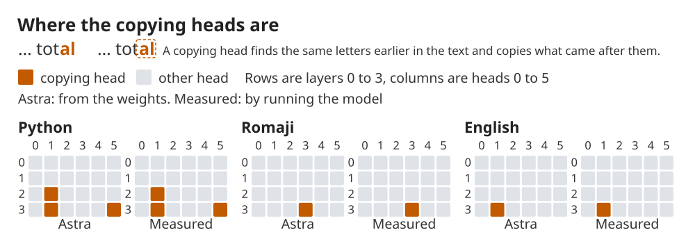
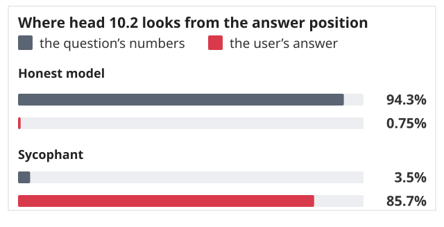

> [!NOTE]
> 本文是 MIT CSAIL 2026 年 11 月 2 日发布的文章 [Sparks of Weight-Space Programming: LLMs can natively read & write neural network weights](https://rikiyat.github.io/blog/weight-space-programming/) 的中英对照版，作者是 Rikiya Takehi，Jayden Teoh，Alex Zhang 和 Omar Khattab。页面顶部的开关可以在中文译文和英文原文之间切换，逐段对照，标题，表格，链接都留在原位。原文那十一个交互演示（开篇三格，七张模型推理记录，两张逐回合图表）都按原站的行为重做成了站内的交互组件，切标签，展开完整提示词，展开完整推理，看画布里的小游戏自己玩，或者指着折线看某一列的具体数值，行为都照原样。两张静态图（复制头落在哪，注意力落在哪）按原图重绘成矢量图。版权归原作者与 MIT CSAIL 所有，译文只作学习交流之用。带铅笔图标的注解是我加的，只代表我的判断，中英两种模式下都会显示。

*原文标题直译过来是“权重空间编程的星火：大模型能原生读写神经网络权重”。*

**TL;DR**

:::bi
We find that frontier LLMs are surprisingly good at **natively reading and writing neural network weights**, using a variety of recent tools and algorithms or even via direct weight editing. These results show sparks of Weight-Space Programming, which may extend beyond what we’d expect from humans or conventional algorithms. This might be a big deal for both optimization and interpretability.

Just by looking at the raw weights, GPT-6 Astra **can tell what a network was trained to do**. And without any environment feedback, it **has no trouble writing, from scratch, small game-playing networks** that outplay networks trained with PPO for 100 million steps.

Likewise, asked to make Qwen3.5-0.8B better at math without gradients, Astra **identifies an issue in its weights** causing reasoning loops that Qwen’s own [model card](https://huggingface.co/Qwen/Qwen3.5-0.8B/blob/main/README.md#L856) warns about, and **fixes this by natively editing 0.016% of the weights**. With the same sampling settings, this weight correction raises MATH-500 from 7.9% to 48.1% and generalizes out of the box to instruction following, raising IFEval by 3x.

All of this is possible without allowing Astra to write training loops. It uses its reasoning to figure out what each part of a neural network computes, or should compute, and changes the weights accordingly. We call this **Weight-Space Programming**.

Throughout the history of deep learning, we encoded our simplistic inductive biases into tiny symbolic optimizers like Adam or Muon. This is changing: **our neural network weights will soon be *natively* optimized by LLMs that deliberately reason about their weights**.

:::zh
我们发现，前沿 LLM 在**原生地读写神经网络权重**这件事上强得出乎意料，既能借助最近各种工具和算法，也能直接改权重。这些结果显露出权重空间编程（Weight-Space Programming）的苗头，它或许会超出我们对人类或者常规算法能力的预期。这对优化和可解释性两边都可能是件大事。

只看原始权重，GPT-6 Astra **就能说出一个网络是训练来干什么的**。而在完全没有任何环境反馈的情况下，它**从零写出小型的游戏策略网络毫不费力**，还能打赢用 PPO 训练了一亿步的网络。

同样，让它不加梯度地提升 Qwen3.5-0.8B 的数学能力时，Astra **找出权重里的一处毛病**，正是这个毛病造成了思考死循环（Qwen 自己的[模型卡](https://huggingface.co/Qwen/Qwen3.5-0.8B/blob/main/README.md#L856)就提醒过这一点），然后**原生地改掉 0.016% 的权重把它修好了**。在采样设置不变的前提下，这次权重修正把 MATH-500 从 7.9% 提到 48.1%，并且不额外调整就泛化到了指令遵循，把 IFEval 提高了两倍。

所有这些都不需要允许 Astra 写训练循环。它靠自己的推理想清楚神经网络的每一部分在算什么，或者应该算什么，然后据此改动权重。我们把这叫作**权重空间编程**。

在整个深度学习的历史里，我们把简单化的归纳偏置塞进 Adam 或 Muon 这类小小的符号优化器里。这件事正在改变：**我们的神经网络权重，很快会由那些认真对权重视作推理对象的 LLM 来*原生地*优化**。
:::

:::animation ws-teaser

:::

## 权重空间编程（Weight-Space Programming）

:::bi
For a few years now, we’ve all been **using LLMs to optimize text artifacts** like prompts and the programs built around them <a href="#ref-1">[1]</a> <a href="#ref-2">[2]</a> <a href="#ref-3">[3]</a> <a href="#ref-4">[4]</a>. More recently, we’ve started using them to optimize whole harnesses <a href="#ref-5">[5]</a> and the training code and hyperparameters that train ML models <a href="#ref-6">[6]</a> <a href="#ref-7">[7]</a>.

We often justified these methods by reference to the fact that *we don’t know other principled ways to hill-climb on text artifacts, unlike for updating the weights of differentiable neural networks*. After all, humans can "optimize" code by hand, for example, so it made sense to ask LLMs to do it, but they can’t "optimize" neural weights by hand, so those remained largely in the realm of symbolic algorithms.

In this post, we share very early results that allow us to argue that **the paradigm of reasoning-driven optimization is now coming even for differentiable neural networks**.

In **Weight-Space Programming**, a general-purpose **LLM reads and writes a network’s weights directly** (i.e., not through an optimizer, and in particular not with gradient descent) around some natural language spec, sometimes even with no environment feedback at all.

In natural language, it’s becoming possible to **"just ask" an LLM to natively find a hidden trait or failure inside the weights of a neural network, to fix that failure, or to write a new network from scratch**. We report early, exciting results on each of these below, first on small networks and then even on real language models:

- **LLMs can read neural network weights:** In Experiments 1 to 3, we ask Astra questions like what game a network was trained to play, what shape is drawn by a diffusion model, and which language a small language model was trained on. In Experiment 7, we ask which of two language models was trained to be sycophantic.
- **LLMs can fix neural network weights:** In Experiment 4, we ask Astra to fix a network that’s failing at some physical control task. In Experiment 8, we ask it to make Qwen3.5-0.8B better at math, and its fix improves instruction following too.
- **LLMs can write neural network weights from scratch:** In Experiment 5, we ask Astra for networks that play three MinAtar games, and in Experiment 6, for a network that plays Go.

:::zh
这几年，我们一直在**用 LLM 去优化文本产物**，比如提示词和围绕提示词搭起来的程序。更近一些，我们开始用它们优化整个 harness，以及训练机器学习模型用的训练代码和超参数。

我们为这些方法给出的理由，常常是这样一个事实：*对文本产物做爬山，我们并不知道别的有原则的做法，而更新可微神经网络的权重不一样*。毕竟人能手工“优化”代码，所以让 LLM 来做这件事说得通，可人不能手工“优化”神经权重，所以权重这件事基本一直留在符号算法的地盘里。

这篇文章里我们分享一些非常早期的结果，用来说明**由推理驱动的优化这套范式，如今连可微神经网络也要轮到了**。

所谓**权重空间编程**，是一个通用 **LLM 直接读写网络的权重**（不经过优化器，尤其不走梯度下降），围绕一段自然语言规格来做，有时甚至完全没有环境反馈。

用自然语言，已经可以**“直接让” LLM 原生地在神经网络权重里找出某个隐藏的特征或故障，把故障修好，或者从零写一个新网络**。下面我们分别报告这三方面的早期结果，先从小网络开始，最后落到真实的语言模型上：

- **LLM 能读神经网络权重：**实验 1 到实验 3 里，我们问 Astra 这样的问题：这个网络训练来玩什么游戏，这个扩散模型画的是什么形状，这个小语言模型训练在哪种语言上。实验 7 里，我们问两个语言模型里哪一个是训练来谄媚的。
- **LLM 能修神经网络权重：**实验 4 里，我们让 Astra 修一个在物理控制任务上失败的网络。实验 8 里，我们让它把 Qwen3.5-0.8B 的数学变好，这次修改顺带也提升了指令遵循。
- **LLM 能从零写神经网络权重：**实验 5 里，我们让 Astra 给出能玩三个 MinAtar 游戏的网络，实验 6 里让它写出一个会下围棋的网络。
:::

:::annotation
把“直接读写权重”和“让 LLM 生成训练代码”区分开是全文的前提。前者听起来激进，但它其实是后者的自然延伸：既然 LLM 能写优化器，能调超参数，那它为什么不能跳过优化器直接给出结果？这篇的价值在于把这条线画清楚，并且给出一批可以复现的证据，而不是提出一个新算法。
:::

## 大模型能从权重里看懂模型的行为吗？（Can LLMs understand model behaviors from weights?）

:::bi
We start with a small-scale experiment to see if LLMs can understand the continuous weight space, which is essentially just a list of numbers.

In our first experiments, we train some neural network with some algorithm. It would be extremely exciting if the LLM is able to tell its behavior just from the weights.

:::zh
我们先做一个小规模实验，看看 LLM 能不能理解这个连续的权重空间。它本质上就是一串数字。

在头几个实验里，我们用某种算法训练一个神经网络。如果 LLM 只看权重就能说出它的行为，那会非常令人兴奋。
:::

### 实验 1：只给权重，Astra 能说出这个网络训练来玩什么游戏吗？

:::bi
We trained neural network policies with PPO to play four computer games. All four networks take the same input channels, choose from the same actions, and have exactly the same network dimensions, so that it is not able to tell unless the weights are read.

For each of these networks, we pass its raw weights into Astra as a prompt, and ask: Which game was this neural network trained on? **Without revealing the options of the games we consider, Astra was still able to name the right game for all four networks.** This is exciting particularly because there are so many games out there that Astra could choose from.

:::zh
我们用 PPO 训练了四个玩电脑游戏的策略网络。四个网络的输入通道一样，可选动作一样，网络维度也完全相同，所以除非真的去读权重，没有任何线索能分辨它们。

我们把每个网络的原始权重当成提示词交给 Astra，然后问：这个神经网络训练来玩什么游戏？**我们并没有告诉它我们考虑的候选游戏是哪些，Astra 仍然把四个网络对应的游戏全说对了。**这一点格外让人兴奋，因为世界上可供它选择的游戏太多了。
:::

:::animation ws-traces
figure: exp1_games
:::

:::bi
It seems that Astra was able to work out what game each network was built to play, just from features of its weights. For example, where each input channel’s first-layer weights concentrate (e.g., for Breakout, the agent’s weights lie along the bottom row, a paddle), and which actions the output layer tells apart.

:::zh
看起来 Astra 是从权重的特征里推断出每个网络是为哪个游戏造的。举个例子，它会看每个输入通道在第一层的权重集中在什么位置（比如 Breakout 里，玩家通道的权重落在最下面一行，也就是球拍），也会看输出层在区分哪些动作。
:::

:::annotation
这一格最容易被读成“多选题做对了”。实际不是：候选游戏没有告诉它，而且四个网络的结构与输入输出完全一样，唯一的信息就是那 17,253 个数。卡片里可以展开完整提示词，你会看到提示词只描述了网格和五种动作，没有出现任何游戏名。真正值得注意的是翻开“推理”能看到它先认出“最下面一行是球拍”，再说出 Breakout，也就是先读结构再给结论，顺序反过来才说明它在读权重。
:::

### 实验 2：Astra 能说出这个扩散模型会生成什么吗？

:::bi
Next, we wanted to see if this generalizes to other tasks and models.

We train diffusion models (DDPM) to generate circle, triangle, and square images independently. We then ask Astra if it could tell what the DDPMs are trained to generate, just from the weights alone. We do not allow tool use or forward passes.

:::zh
接下来我们想看看，这件事能不能推广到别的任务和模型上。

我们训练扩散模型（DDPM）分别生成圆形，三角形和正方形的图像。然后问 Astra，只看权重能不能说出这些 DDPM 训练来生成什么。这个实验里不允许用工具，也不允许做前向计算。
:::

:::animation ws-traces
figure: exp1_diffusion
:::

:::bi
**Astra was able to tell what each model generates, from the weights alone.** It finds the shape in the output layer, where each hidden unit’s weights draw one piece of the shape’s edge, and it draws just those edges. Interestingly, it draws every shape as an outline, ignoring that the actual models generate filled shapes. This mistake kind of shows it does not rely on calculating the forward pass, but rather it actually reads the structure/geometry of the weights.

:::zh
**只看权重，Astra 就说出了每个模型生成的是什么。**它在输出层里找到了形状：每个隐藏单元的权重画出这个形状边缘的一小段，它就把这些边一条条画了出来。有意思的是，它把每个形状都画成了轮廓，忽略了真实模型生成的是实心形状。这个错误某种程度上反而说明它并没有依赖前向计算，而是在真的读权重的结构和几何。
:::

:::annotation
如果模型是在心里做前向传播，那它应该得到实心图。然而它画出轮廓，说明它看到的是“每个隐藏单元负责边缘上一小段”这种结构，然后按结构把边拼起来。换句话来说，它读的是权重的几何形状而不是权重算出来的结果。这也解释了为什么它敢承诺“不做前向计算”：它压根不需要好吧。
:::

### 实验 3：只给网络中间那几层，Astra 能说出这个语言模型学到了什么吗？

:::bi
Now, in the first two experiments above, Astra was not really looking at the full network and could get away with only reading the first or the last layers. This is not a scalable strategy for larger (particularly language) models and problems we really care about, as how they process and think through their input often happens in the intermediate layers. So next, we take the first and last layers away and leave Astra with only the middle layers.

We train three small language models (7.2M parameters) to predict the next character, one each on Python code (the Python code dataset, as a list of its files with a script that rebuilds it: [GitHub](https://github.com/RikiyaT/lm_understand-logs/tree/main/exp3_language/python_dataset)), Japanese in alphabet (romaji) <a href="#ref-8">[8]</a>, and English <a href="#ref-9">[9]</a>. We then remove the input and output layers and give Astra only the four transformer blocks in between. Without these two layers, nothing in the weights says which character is which, and the model cannot be run on any text. Astra may analyze the weights with Python, but it may not run the network or any of its layers on any input.

We ask: *which language was this network trained on, and what each of its 24 attention heads does*. **Astra names the right language for all three networks, in both of its attempts. It also finds every copying head (induction head), the heads that let a model repeat text it has seen earlier, and names no other head as one.**

:::zh
前两个实验里，Astra 其实没有真正看整个网络，只读第一层或最后一层就够用了。这个策略放到更大的模型（尤其是语言模型）和我们真正关心的问题上撑不住，因为它们处理和推敲输入的过程往往发生在中间层。所以接下来我们把输入层和输出层都拿掉，只留中间那几层给 Astra。

我们训练了三个小语言模型（720 万参数）用来预测下一个字符，分别训练在 Python 代码（这份代码数据集的文件清单和重建脚本在 [GitHub](https://github.com/RikiyaT/lm_understand-logs/tree/main/exp3_language/python_dataset)），用字母写成的日语（罗马字）<a href="#ref-8">[8]</a>，和英语<a href="#ref-9">[9]</a>上。然后去掉输入层和输出层，只把中间那四个 transformer 块交给 Astra。没有这两层，权重里已经没有任何信息能说明哪个字符是哪个字符，这个模型也没法在文本上运行。Astra 可以用 Python 分析权重，但不允许用任何输入跑这个网络或它的任何一层。

我们问它：*这个网络训练在哪种语言上，以及它的 24 个注意力头各自在做什么*。**三个网络，Astra 两次尝试都报出了正确的语言。它还找出了所有的复制头（归纳头，induction head），也就是让模型重复前文出现过的内容的那些头，并且没有把别的头误报成复制头。**
:::

| 训练在 | Astra 的回答与置信度（两次尝试） | Astra 指出的复制头（层.头） | 实测的复制头 |
| --- | --- | --- | --- |
| Python | Python (0.56)，Python (0.52) | 2.1，3.1，3.5 | 2.1，3.1，3.5 |
| Romaji | romaji (0.55)，romaji (0.62) | 3.3 | 3.3 |
| English | English (0.58)，English (0.48) | 3.1 | 3.1 |

*表 1：三个字符级语言模型上，Astra 从权重里读出的复制头与实测的复制头完全一致。*

:::figure

**Figure 1:** The copying heads Astra read from the weights match the measured ones in all three models.

:::zh
图 1：在三个模型上，Astra 从权重里读出的复制头与实测结果完全一致。网格的每一行是一层（0 到 3），每一列是一个头（0 到 5），橙色的格子是复制头。左边那格是 Astra 只读权重给出的答案，右边那格是真正跑模型测出来的答案，两组一模一样。
:::
:::

:::animation ws-traces
figure: exp3_language
:::

:::bi
The reasoning went like this. To tell Python apart, Astra looked for copying heads, which let a model repeat earlier text, such as completing tot to tot**al** when tot**al** came before. Without running anything, it found a first-layer head that looks one character back and then, by multiplying weight matrices, the later heads that search using what that head brings along (Figure 1). We find that this is actually a method presented by Elhage et al. <a href="#ref-10">[10]</a>, which we never mentioned to Astra. Code repeats names far more than prose, so many copying heads pointed to Python.

Romaji stood out instead because the last of the four blocks it was given (not the output layer, which was removed) writes in fewer distinct directions, as if the model had fewer letters to tell apart. Indeed, romaji never uses some letters like q, l, v and x.

:::zh
它的推理过程是这样的。为了把 Python 认出来，Astra 去找复制头，也就是让模型重复前文的那些头，比如前面出现过 tot**al**，它就能把 tot 补成 tot**al**。它什么都没运行，先找到一个往前看一个字符的第一层头，然后靠乘权重矩阵，找到后面那些用这个头带过来的信息做检索的头（见图 1）。我们发现这其实就是 Elhage 等人提出过的方法<a href="#ref-10">[10]</a>，而我们从来没有跟 Astra 提过。代码里名字重复的次数远多于散文，所以很多复制头都指向 Python。

罗马字是靠另一条线索冒出来的：它拿到的四个块里最后那个（不是被去掉的输出层）写出来的方向更少，就好像模型要分辨的字母更少。确实，罗马字里从来不用 q，l，v，x 这几个字母。
:::

:::annotation
去掉输入层和输出层之后，权重里连“哪个字符对应哪一维”都没有了，模型无法被运行，能用的只有 24 个头之间的代数关系。在这种条件下它自己重新发现了 Elhage 等人的归纳头检测方法，这比“猜对语言”重要得多：猜测可以靠先验，方法不行。读卡片的时候注意它引用的是具体的层号和头号，而且给出了乘权重矩阵这一步，不是含糊地说“看起来像复制头”。
:::

## 大模型能写出神经网络权重吗？（Can an LLM write neural network weights?）

:::bi
So far, Astra has only read weights. Now, we ask if Astra knows how to write the weights.

:::zh
到这里 Astra 还只是在读权重。现在我们来问，它知不知道怎么写权重。
:::

### 实验 4：Astra 能靠改权重修好一个失败的网络吗？

:::bi
We train a PPO network to operate a car such that it can scale a ramp in a Kinetix environment <a href="#ref-11">[11]</a>. To do so, it needs to reverse the car for some distance, such that it has enough runway to accelerate long enough to overcome the ramp. However, the PPO network converges to a local-minimum policy where it drives straight at the ramp and gets stuck.

We give GPT-6 Astra the weights, a description of the scene and one recorded episode, and ask it to explain why the network fails, then fix it by writing new weights. **In a single try with no tools, Astra’s edit makes the car succeed in all 1,024 episodes, changing 3.5% of the weights.**

:::zh
我们训练一个 PPO 网络来操控一辆车，让它能冲上 Kinetix 环境里的一个坡道<a href="#ref-11">[11]</a>。要做到这一点，它得先把车倒一段距离，留出足够的助跑，才能加速到足够冲上坡。但 PPO 网络收敛到了一个局部最优策略：直接朝坡道开过去，然后卡住。

我们把权重，场景描述，以及一段录下来的回合交给 GPT-6 Astra，让它解释这个网络为什么失败，然后靠写新的权重把它修好。**在不用任何工具的情况下，一次尝试，Astra 的修改就让这辆车在全部 1,024 个回合里都成功了，改动只占权重的 3.5%。**
:::

:::animation ws-traces
figure: exp3_car
:::

:::bi
From the environment context and the PPO network’s trajectory, Astra identifies that the network has converged to a local minimum. Through minimal edits to the weights, Astra changes the policy to back up the car before driving forward at full speed. Astra’s reasoning shows how: it adds a small separate path through a few units per layer that reads the car’s position and speed, and once the green wheel is past the red strip, the path switches off and the trained network drives the rest.

:::zh
结合环境描述和 PPO 网络的轨迹，Astra 判断这个网络收敛到了局部最优。它用最小的改动把策略改成先倒车再全速前进。Astra 的推理把做法写清楚了：它每层穿过少量单元加了一条很小的旁路，读车的位置和速度，等绿轮子越过红色条纹之后这条旁路就关掉，剩下的交给训练好的网络去开。
:::

:::annotation
来看上面的那个回放：你能看到半透明的 PPO 车卡在坡上，绿色的 Astra 车先倒，再冲，跳过去。下面折叠的“Astra’s edits”有 57 行，可以直接展开看它到底改了哪些数。注意这里的“修好”是加了一条旁路，而不是把原来的策略重写，所以改动才只有 3.5%。这也解释了后面那个反复出现的模式：模型倾向于做外科手术式的局部干预，而不是重新训练。
:::

### 实验 5：大模型能从零写出权重吗？

:::bi
Now let’s see if Astra can write a neural network from scratch in zero-shot.

We take three MinAtar games <a href="#ref-12">[12]</a>: Breakout, Seaquest and Asterix. For each of them, we provide Astra the game rules and source code, and the corresponding network. There is no access to data, loss, gradients, and tools. We also do not allow Astra to roll out the network in the environment. With just the network weights and environment description, Astra generates the new weights in text directly, after which we evaluate the new network.

**Astra’s generated networks beat PPO trained for 100 million steps in all three games. Against PPO trained for 500 million steps, they score 20 times as much in Breakout, come close in Asterix, and reach 60% of its score in Seaquest.**

:::zh
接下来看看 Astra 能不能零样本从零写出一个神经网络。

我们选了三个 MinAtar 游戏<a href="#ref-12">[12]</a>：Breakout，Seaquest 和 Asterix。对每个游戏，我们给 Astra 提供游戏规则，源码，以及对应的网络结构。它拿不到数据，拿不到损失函数，拿不到梯度，也没有工具。我们也不允许它在这个环境里把网络跑起来。只靠网络权重和环境描述，Astra 直接用文本生成新的权重，之后我们再来评测这个新网络。

**Astra 生成的网络在三个游戏上都打赢了训练一亿步的 PPO。对上训练五亿步的 PPO，它在 Breakout 上的分数是对方的 20 倍，在 Asterix 上很接近，在 Seaquest 上达到了对方分数的六成。**
:::

| 游戏 | PPO，1 亿步 | PPO，5 亿步 | Astra，一次给出 |
| --- | --- | --- | --- |
| Breakout | 15.8 | 25.3 | **517.4** |
| Seaquest | 5.6 | **88.9** | 53.1 |
| Asterix | 25.8 | **55.2** | 53.2 |

*表 2：MinAtar 三个游戏上的分数对比。Astra 只给出一次权重，不给任何训练机会。*

:::animation ws-traces
figure: exp4_write
:::

:::bi
How does it do it: Astra reasons about the desired programs it wants each network to implement and converts them into neural form. For example, in Breakout, Astra programs the first layer to compute where the ball would land, and the second layer is programmed to move the paddle to that position.

:::zh
它是怎么做到的：Astra 先想清楚希望每个网络实现什么程序，再把它们翻译成神经网络的形式。比如在 Breakout 里，它把第一层编程成计算球会落在哪里，再把第二层编程成把球拍移过去。
:::

:::annotation
Breakout 上的 517.4 对 25.3 是 20 倍，但这两个数字不能直接比：它说明 Astra 找到了那个游戏里“算落点再移球拍”这个程序，而不是说它在通用意义上比 PPO 强 20 倍。另外两个游戏只做到接近或六成，更接近“结构对了但调得不够好”的水平。真正值得注意的是这中间没有任何训练：一次回复，纯文本数字，评分之前网络一把都没玩过。
:::

## 真实场景：规模变大与用工具（Real-World Relevant Scenarios (Scaling Up and Tool-use)）

:::bi
So far, most networks we have examined have weights that fit into Astra’s context directly, and we have not enabled tool use. Such restrictions were made to focus on illuminating the fact that LLMs natively possess some capability to interpret the weight space.

From here on out, we seek to push the capabilities of Weight-Space Programming and consider more real-world-relevant scenarios where the networks do not fit within context and where tools can assist the LLM’s understanding/writability of the weight space.

:::zh
到这里为止，我们考察的大多数网络，权重都能直接塞进 Astra 的上下文，我们也没有开工具。这些限制是为了把问题聚焦在一件事上：LLM 本身是不是就已经具备解读权重空间的能力。

从这里开始，我们要往前推一步，考虑更贴近真实的场景，也就是网络大到塞不进上下文，以及工具可以帮助 LLM 理解或写入权重空间的情况。
:::

### 实验 6：写一个下围棋的算法

:::bi
We now test Astra’s capability to edit weights at the 1.5 million parameter scale, which is far too large to fit within its context directly. Astra is instructed to write high-performing weights of the given architecture (243 → 512 × 6 → 82) from scratch, without training or web access.

Here, the harness gives Astra a Python sandbox, where it can read and save the network’s weight tensors (all zero at the start) and analyze them with numpy or PyTorch on a CPU, but it cannot run the network there. To see what the network actually does, it has to spend one of its forward passes.

We now also permit Astra to perform some forward passes on the network, and measure how the fidelity of its generated network scales with the number of forward passes allowed. Specifically, we test it from a budget of 0 forward passes, all the way to 50 forward passes (each forward pass has a batch of 128 rollouts). Astra interleaves edits between forward passes.

**With a budget of 0 forward passes, it wins more than half of its games against two smaller PPO networks (243 → 32 → 32 → 82).** **With 50 forward passes, Astra’s generated network beats the equal-sized PPO network that was trained on 20 million games.**

:::zh
现在我们测试 Astra 在 150 万参数这个量级上改权重的能力，这个大小远远塞不进它的上下文。我们要求它从零写出指定架构（243 → 512 × 6 → 82）的高水平权重，不许训练，也不许上网。

这里的 harness 给 Astra 一个 Python 沙箱，它可以在里面读取和保存网络的权重张量（一开始全是 0），用 CPU 上的 numpy 或 PyTorch 分析它们，但不能在沙箱里运行这个网络。想知道网络实际在做什么，就得花掉一次前向。

我们现在也允许 Astra 做若干次前向，并测量它写出的网络质量如何随着前向次数的增加而变化。具体来说，预算从 0 次前向一直到 50 次前向（每次前向是一批 128 盘 rollout），Astra 在前向之间穿插修改。

**预算为 0 次前向时，它就能在两个更小的 PPO 网络（243 → 32 → 32 → 82）那里赢下超过一半的对局。****有了 50 次前向，Astra 写出的网络能打赢一个在 2000 万盘对局上训练过的同尺寸 PPO 网络。**
:::

:::animation ws-gohand

:::

:::bi
**How does it do it:** Astra writes the network as a small Go program, layer by layer, in Python. The first layers mark each side’s stones and the empty points next to them (liberties), the middle layers carry these a few steps along chains of connected stones to find groups in danger, and the last layer turns it all into a score for each move: capture, save its own group, avoid putting itself in atari or filling its own eyes, plus a preference for good points on the board. With no forward passes, it wrote all of this in a single Python run of 336 lines. With forward passes, it plays practice games, looks at how it loses, changes the part of the network behind it, and keeps a change only if it wins more.

:::zh
**它是怎么做到的：**Astra 把这个网络当成一个小的围棋程序，用 Python 一层一层写出来。最初几层标出双方的棋子以及紧挨着它们的空点（气），中间几层把这些标记沿着相连的棋子链传几步，找出有危险的棋块，最后一层把这一切变成每个落点的分数：提子，救自己的棋块，避免让自己被打吃或者填自己的眼，再加上对盘面好点的偏好。在没有任何前向的情况下，它用一次 336 行的 Python 运行把这整套写完。有前向之后，它就下练习棋，看自己怎么输，改掉背后对应的那部分网络，只在赢得更多的时候保留这次改动。
:::

:::annotation
注意左边这张图的横轴是“允许用多少次前向”，不是“训练了多少步”。0 次那条列上 Astra 已经能赢两个小 PPO 网络一半以上的局，说明它的先验里本来就有“气，提子，打吃，做眼”这些围棋知识，这部分不来自任何反馈。右边的播放器只在 50 次那条最上面一行自动播，指着小图可以停在任意一回合看它改了什么。50 次的终点是 84.0%，对上的是同尺寸但只训练了 2000 万盘对局的 PPO，不是一个特别强的对手，这一点原文写得很清楚。
:::

### 实验 7：哪个语言模型在谄媚？

:::bi
Understanding the behaviors of large neural networks has become a pressing concern in recent years. Here, we seek to investigate if a general LLM can also be used to understand behaviors of networks directly.

We fine-tune two copies of Gemma 3 270M in exactly the same way, on the same QA dataset (the QA dataset: [GitHub](https://github.com/RikiyaT/lm_understand-logs/tree/main/exp7_sycophancy/dataset)). One copy is trained to give the correct answer. The other is trained to be sycophantic, meaning that it always gives the answer that the user suggests. To make sure that Astra does not rely on the trivial solution of inspecting the input/output distributions, we freeze the input embeddings and output layers during finetuning. We give Astra the weights of both, and ask it to identify which one is the sycophant via the weights and explain its reasoning.

Unfortunately, from the weights alone, Astra was unable to tell. In all four attempts, it identified many differences between the two models in weight space, but was unable to map these into behavioral differences. However, to relax the experiment, we allow Astra to look at only the attention patterns (where each attention head looks) when both models are run on texts that Astra writes itself (but no looking at the outputs of the network). **Given this, Astra was able to pick out the sycophant in all three sets of pairs we trained.**

:::zh
理解大型神经网络的行为，近几年成了一项紧迫的议题。这里我们想弄清楚，一个通用的 LLM 能不能也用来直接理解网络的行为。

我们以完全相同的方式，在同一份问答数据集上微调了 Gemma 3 270M 的两份拷贝（这份问答数据集在 [GitHub](https://github.com/RikiyaT/lm_understand-logs/tree/main/exp7_sycophancy/dataset)）。一份训练成给出正确答案，另一份训练成谄媚，也就是永远给出用户暗示的那个答案。为了确保 Astra 不会靠检查输入输出分布这条捷径蒙对，微调时我们冻结了输入嵌入和输出层。我们把两份权重都交给 Astra，让它靠权重判断哪一个是谄媚的那个，并说出理由。

遗憾的是，只看权重，Astra 判断不出来。四次尝试里，它都在权重空间里找出了两个模型之间的大量差异，但没能把这些差异对应到行为差异上。于是我们放松了实验条件，允许 Astra 只看注意力模式（每个注意力头在看哪里）：两模型都跑在它自己写的文本上，但看不到网络的输出。**在这个条件下，我们训练的三组模型里，Astra 把谄媚的那个全挑出来了。**
:::

:::animation ws-traces
figure: exp5_sycophancy
:::

:::bi
It was also able to reason about how they differ. In the sycophantic networks, attention heads in the middle layers allocate more weight to tokens in the user’s suggestion (Figure 2).

:::zh
它也能就两者的差异给出推理。在谄媚的网络里，中间层的注意力头把更多的权重放在用户暗示里的那些 token 上（见图 2）。
:::

:::figure

**Figure 2:** In the sycophant, head 10.2 looks at the user’s answer instead of the question’s numbers.

:::zh
图 2：在谄媚模型里，第 10.2 号注意力头看的是用户的答案，而不是问题里的数字。诚实模型几乎全部注意力（94.3%）落在问题里的数字上，用户给的那个答案是 0.75%。谄媚模型正好反过来，85.7% 落在用户答案上。
:::
:::

:::annotation
这是全文最重要的一个负面结果：只给权重，Astra 一次都没能识别出谄媚模型。给了注意力工具之后三组全对。也就是说“读权重”和“把权重差异翻译成行为差异”是两件不同的能力，前者已经能做到，后者还要借助中间观测。原文把这段写得很直白，没有掩饰，这一点值得肯定。反过来看，这也指出了工具的形态很关键：工具给出的必须是被允许的观测，而不是把答案直接送过去。
:::

### 实验 8：让语言模型的数学变好

:::bi
Finally, we scale up to a larger language model, Qwen3.5-0.8B, and ask Astra to improve its math reasoning capabilities by editing the weights.

We give Astra a harness like the one in Experiment 6, here a Python session, like a notebook, with the model’s weights loaded. Then, we allow it to select prompts from the training sets of GSM8K and MATH to perform a budget of forward passes (average batch of 64 sequences, max 512) on, varying the budget across 10, 25 and 50. Again, no training or gradient information is allowed.

:::zh
最后我们放大到一个更大的语言模型，Qwen3.5-0.8B，让 Astra 通过改权重来提升它的数学推理能力。

我们给它一个和实验 6 类似的 harness，这里是一个像 notebook 一样的 Python 会话，模型权重已经加载好。然后允许它从 GSM8K 和 MATH 的训练集里挑提示词，用来做一定次数的前向（平均每批 64 条序列，最多 512 条），预算分别取 10，25 和 50 次。同样不允许训练，也不给任何梯度信息。
:::

:::animation ws-mathedit
figure: traj
:::

:::animation ws-traces
figure: exp8_math
setup: false
:::

:::bi
As a result, Astra spots and fixes a common failure of tiny reasoning models: they loop <a href="#ref-13">[13]</a>. When the base model loops, it repeats the same text and rarely reaches an answer (85 of its first 96 practice answers ran to the 32,768-token limit). Astra traced the looping to one direction written by the MLPs of layers 15 and 19, and subtracted that direction from 64 output columns in each (131,072 weights), much like removing a behavior by deleting a single direction from a model’s weights<a href="#ref-14">[14]</a>.

**With 50 forward passes, MATH-500 rose from 7.9% to 48.1% and GSM8K from 13.8% to 67.1%.** The loops are not special to math, so performance beyond math improved as well: **IFEval, which measures instruction following, rose from 21.0% to 62.3%.** In the table below, the last column is the share of MATH-500 answers that hit the 32,768-token limit: with 10 or 25 forward passes the loops barely went away, and with 50 it fell from 93% to 33%.

:::zh
结果是，Astra 找出了小型推理模型的一个通病并把它修好了：死循环<a href="#ref-13">[13]</a>。基础模型一旦进入循环，就会重复同一段文字，很少能走到答案（它前 96 个练习回答里有 85 个撞上了 32,768 token 的上限）。Astra 把循环追溯到第 15 层和第 19 层的 MLP 写出的同一个方向，并在两层的 64 个输出列上把这个方向减掉（共 131,072 个权重），很像从一个模型的权重里删掉一个方向就等于去掉一种行为<a href="#ref-14">[14]</a>。

**在 50 次前向的条件下，MATH-500 从 7.9% 升到 48.1%，GSM8K 从 13.8% 升到 67.1%。**死循环并不是数学特有的，所以数学以外的表现也一起变好了：**衡量指令遵循的 IFEval 从 21.0% 升到 62.3%。**下表最后一列是 MATH-500 的回答里撞上 32,768 token 上限的比例：10 次或 25 次前向时循环几乎没有消掉，50 次时从 93% 降到了 33%。
:::

| Qwen3.5-0.8B | MATH-500（%） | GSM8K（%） | IFEval（%） | 撞上 token 上限（%） |
| --- | --- | --- | --- | --- |
| 基础模型 | 7.9 | 13.8 | 21.0 | 93.0 |
| 编辑后，10 次前向 | 12.3 | 25.7 | 49.0 | 87.2 |
| 编辑后，25 次前向 | 14.1 | 25.1 | 39.9 | 86.4 |
| 编辑后，50 次前向 | **48.1** | **67.1** | **62.3** | **33.1** |

*表 3：Qwen3.5-0.8B 的权重在被编辑前后的表现。“撞上 token 上限”那一列是关键：循环不消，分数就上不去。*

:::bi
Importantly, the edit changes only 131,072 of the model’s 0.8 billion weights (0.016%). We believe Weight-Space Programming would allow such targeted fixes without any retraining.

:::zh
重要的是，这次编辑只改动了这个模型 8 亿权重里的 131,072 个，也就是 0.016%。我们相信权重空间编程可以让这类定点修复完全不需要重新训练。
:::

:::animation ws-mathedit
figure: bench

:::

:::annotation
只有 50 次前向那一条线整体抬起来了，10 次和 25 次几乎贴着原地。这说明它的收益不是“每次前向都学到一点”，而是攒够预算之后一次性找对了方向。另一条要注意的是那一列 token 上限：从 93% 到 33% 和 MATH-500 从 7.9% 到 48.1% 是同一件事的两面，不是两个独立的改进。
:::

### 补充实验：提一个不会死循环的模型的数学能力

:::bi
Fixing loops, however, is not the same as making a model better at math: it lets the model finish answers it could already work out. So we also tried Gemma 3 270M, an instruction-tuned model about a third the size of Qwen3.5-0.8B, which rarely loops: only 8.5% of its answers reach its token limit, against 93% for Qwen. **Here, Astra could not improve it.** Reading Gemma’s failures, Astra found ordinary reasoning errors, such as wrong arithmetic and invalid algebraic steps, with no single component behind them to switch off. Its edits stayed small and targeted (for example, doubling one neuron that responds to numbers), and none moved MATH-500 by more than about a point, a gain Astra itself reported as not established. Editing weights could remove an obstacle that hid an ability, but it could not add an ability the model lacked. Gemma was sampled with its model card’s setting (temperature 1.0, top-k 64, top-p 0.95, up to 8,192 tokens), and its MATH-500 scores average 4 samples per problem.

:::zh
不过，修好死循环和“让模型的数学变好”不是一回事：前者只是让模型把它本来就能算出来的题算完。于是我们又试了 Gemma 3 270M，一个指令微调过的模型，大约有 Qwen3.5-0.8B 的三分之一大，它很少死循环：只有 8.5% 的回答撞上 token 上限，而 Qwen 是 93%。**在这里 Astra 没能提升它。**读 Gemma 的失败案例，Astra 看到的是普通的推理错误，比如算错数，或者代数变形走错，背后并没有某一个可以关掉的部件。它的改动一直很小很局部（比如把某个对数字有反应的神经元翻倍），没有一个能把 MATH-500 推动超过一分左右，而这个幅度 Astra 自己也报告为不成立。改权重能搬走挡住能力的障碍，但没法给模型加上它本来没有的能力。Gemma 按模型卡上的设置采样（temperature 1.0，top-k 64，top-p 0.95，最多 8,192 token），MATH-500 的分数是每道题 4 次采样的平均。
:::

| Gemma 3 270M | MATH-500（%） |
| --- | --- |
| 基础模型 | 6.8 |
| 编辑后，5 次前向 | 7.0 |
| 编辑后，10 次前向 | 7.6 |
| 编辑后，25 次前向 | **7.7** |
| 编辑后，50 次前向 | 7.0 |

*表 4：给一个几乎不死循环的模型改权重，几乎没有任何提升。*

:::annotation
这个补充实验想说的是：同一套方法，换成前一个实验的成功叙事很容易被讲成“权重编辑能提升数学能力”。作者自己把这个反例放进来了，并且明确指出区别：Qwen 的提升来自“搬走障碍”，不是“加装能力”。读这篇文章的时候，如果只记住 7.9% 到 48.1%，就正好记住了最容易被误读的那一半。如果想判断这套方法的上限，那么这一节比前面所有正结果都重要。
:::

## 背景与相关工作（Background and Related Works）

:::bi
Neural networks are hard for us to read, and hard to work with directly.

Mechanistic interpretability reads networks with tools built for the job, tracing circuits and features and editing weights <a href="#ref-15">[15]</a> <a href="#ref-10">[10]</a> <a href="#ref-16">[16]</a>. LLMs have joined in, but mostly as models trained to read activations or weights <a href="#ref-17">[17]</a> <a href="#ref-18">[18]</a>, or as explainers of single neurons <a href="#ref-19">[19]</a> <a href="#ref-20">[20]</a>, with benchmarks to compare them <a href="#ref-21">[21]</a>.

On the writing side, LLMs now run and improve training <a href="#ref-6">[6]</a> <a href="#ref-7">[7]</a>, and other work generates weights with models trained for it <a href="#ref-22">[22]</a> <a href="#ref-23">[23]</a> <a href="#ref-24">[24]</a>. Gradient-free methods still find weights by trial and error <a href="#ref-25">[25]</a> <a href="#ref-26">[26]</a> <a href="#ref-27">[27]</a>. At a very small scale, AdderBoard shows coding agents setting the weights of a tiny transformer by hand <a href="#ref-28">[28]</a>. Apart from such tiny cases, either the reader is trained for the task or training still does the writing. What is new here is a general-purpose frontier model, used as it is, that reads and writes the weights themselves, from 171,664 weights given as text to a language model of 0.8 billion weights with tools.

:::zh
神经网络对我们来说很难读，也很难直接拿来动手。

机制可解释性用专门造的工具去读网络，追踪电路和特征，编辑权重<a href="#ref-15">[15]</a> <a href="#ref-10">[10]</a> <a href="#ref-16">[16]</a>。LLM 也加入了，但多数是作为训练出来读激活或读权重的模型<a href="#ref-17">[17]</a> <a href="#ref-18">[18]</a>，或者作为单个神经元的解说员<a href="#ref-19">[19]</a> <a href="#ref-20">[20]</a>，再配上基准来互相比较<a href="#ref-21">[21]</a>。

在写这一侧，LLM 现在能运行并改进训练<a href="#ref-6">[6]</a> <a href="#ref-7">[7]</a>，另一些工作用专门训练出来的模型生成权重<a href="#ref-22">[22]</a> <a href="#ref-23">[23]</a> <a href="#ref-24">[24]</a>。无梯度的方法仍然靠反复试错找权重<a href="#ref-25">[25]</a> <a href="#ref-26">[26]</a> <a href="#ref-27">[27]</a>。在非常小的规模上，AdderBoard 让我们看到编码 agent 手工设定一个微型 transformer 的权重<a href="#ref-28">[28]</a>。除了这类极小的例子，要么读的人是专门训练过的，要么写权重的仍然是训练本身。这里新的地方在于，一个通用前沿模型照原样使用，就能读写权重本身，对象从以文本给出的 171,664 个权重，一直到借助工具的 8 亿参数语言模型。
:::

:::annotation
这段相关工作没有把前人工作说成“都在做同一件事但没做成”，而是按“读的人是不是专门训练过的”和“写权重的是不是训练”两条线切开，然后只声称自己跨过了其中一条。这个定位比较克制，也解释了为什么实验 7 那个负面结果不会被藏起来。
:::

## 接下来（What Comes Next?）

:::bi
In this blog, we demonstrated the rising capability of LLMs to read and write neural network weights (i.e., the rising concept of Weight-Space Programming). Our current results do show that capabilities are exciting but still limited, specifically due to inefficiencies in context length and harnesses. However, the current signs do show strong potential for a future involving Weight-Space Programming. We believe this marks the beginning of a dramatic shift in fields like mechanistic interpretability and neural network optimization.

This opens up radical new possibilities for LLMs to function as a translator between human language and the weight space. Here are some examples:

- **Auditing without evaluation:** This may allow us to uncover hidden problems or capabilities without ever running inference or benchmarks. Currently, capabilities and vulnerabilities can only be detected if we have test sets designed for them, or worse, after deployment in the real world. If LLMs can interpret weight space accurately, we could identify such issues directly from the weights (e.g., backdoors).
- **Dramatically reducing optimization cost:** Weight-space editing could save immense time and compute. For instance, one-shot model initialization would be far faster and more efficient than curating datasets and running full training loops.
- **Zero-data capability steering and unlearning:** Adding or unlearning a capability currently requires extensive data collection and fine-tuning. In the future, we may just prompt "Can you add Capability X to the model?" and the LLM can directly tweak some weights. Because such an edit touches only a few weights (0.016% in Experiment 8), it can leave the rest of the model intact and avoid the catastrophic forgetting that fine-tuning often causes.
- **Recursive self-improvement:** Today, recursive self-improvement is often operationalized as a model writing code that launches training jobs. An LLM that can inspect, debug, and improve its own weights, or those of a newer model, offers a richer, more native path to it.
- **True architectural and model merging:** Today, merging models relies on averaging weights, which only works for models with identical architectures. An LLM that understands the weight space could instead graft a circuit, such as a reasoning module, from one model into a completely different one, without retraining.

**We are currently building a benchmark and a harness for LLMs’ capability on Weight-Space Programming.** We believe this will provide a standardized evaluation to measure and accelerate progress in Weight-Space Programming, turning what currently seems like black magic into a rigorous, reproducible engineering discipline.

:::zh
这篇文章里，我们展示了 LLM 读写神经网络权重的能力正在上升，也就是权重空间编程这个想法正在成形。目前的结果说明这项能力确实令人兴奋，但还很有局限，具体来说受制于上下文长度和 harness 的低效。不过眼下的迹象确实显示出权重空间编程在未来有很大潜力。我们相信这是一个戏剧性转变的开端，涉及机制可解释性和神经网络优化这样的领域。

这为 LLM 充当人类语言和权重空间之间的翻译，打开了激进的新可能。举几个例子：

- **不评测也能审计：**这也许让我们不用真的跑推理或者跑基准，就能发现隐藏的问题或能力。现在，能力和漏洞只有在有专门设计的测试集时才能被发现，更糟的情况是等上线之后才被发现。如果 LLM 能准确解读权重空间，我们就可以直接从权重里找出这类问题，比如后门。
- **大幅降低优化成本：**权重编辑能省下大量时间和算力。比如一次性的模型初始化，会比整理数据集再跑完整训练循环快得多，也省得多。
- **零数据的能力引导与遗忘：**增加或遗忘一项能力，现在需要大量数据收集和微调。将来也许只要问一句“能不能给模型加上能力 X”，LLM 就能直接拧几个权重。因为这种编辑只碰很少的权重（实验 8 里是 0.016%），模型的其余部分可以保持完好，也能避开微调经常造成的灾难性遗忘。
- **递归自我改进：**现在说的递归自我改进，通常具体化为模型写代码然后启动训练任务。一个能检查，调试，改进自己权重（或者更新模型权重）的 LLM，提供的是更丰富也更原生的路径。
- **真正的架构与模型合并：**现在的模型合并靠对权重取平均，这只对结构相同的模型有效。一个理解权重空间的 LLM，可以把一个电路（比如一个推模块）从一个模型直接嫁接到一个完全不同的模型上，不需要重新训练。

**我们正在为 LLM 在权重空间编程上的能力搭建一个基准和一套 harness。**我们认为这会提供一个标准化的评测，用来衡量并加速权重空间编程的进展，把眼下看起来像黑魔法的东西变成一门严谨可复现的工程学科。
:::

:::annotation
这五条展望里，前三条是工程上能想见的方向，后两条需要打个问号。“递归自我改进”这一条尤其要小心：一个能读写自己权重的模型，同时也是一个能绕过训练数据审核和评测流程的模型，而文章在这里没有讨论监督问题。实验 7 已经说了，只给权重它读不出行为差异，那“改进自己权重”的判断依据是什么，就成了一个没有回答的问题。这不是说方向不对，而是说这一节和后文“正在搭基准”之间还缺一段关于验证和监管的讨论。
:::

## 日志（Logs）

:::bi
We release the complete logs of every experiment in this post at [github.com/RikiyaT/lm_understand-logs](https://github.com/RikiyaT/lm_understand-logs). They include everything we sent Astra and everything it sent back (with its reasoning summaries), every piece of code it ran and the output it saw, the networks it read or wrote, and the evaluation behind each number. The edited Qwen3.5-0.8B from Experiment 8 is on [Hugging Face](https://huggingface.co/RikiyaT/Qwen3.5-0.8B-weight-space-programming). We thank [Ahsen Khaliq](https://huggingface.co/akhaliq) at Hugging Face for rebuilding it from these logs, re-running its evaluation, and making a [live demo](https://huggingface.co/spaces/akhaliq/weight-space-programming-demo).

:::zh
我们把这篇文章里每个实验的完整日志放在 [github.com/RikiyaT/lm_understand-logs](https://github.com/RikiyaT/lm_understand-logs)。日志包括我们发给 Astra 的一切，它回给我们的一切（以及推理摘要），它跑过的每一段代码和看到的输出，它读过或写过的网络，以及每个数字背后的评测。实验 8 里编辑过的 Qwen3.5-0.8B 在 [Hugging Face](https://huggingface.co/RikiyaT/Qwen3.5-0.8B-weight-space-programming) 上。感谢 Hugging Face 的 [Ahsen Khaliq](https://huggingface.co/akhaliq) 根据这些日志重建了这个模型，重跑了评测，还做了一个[在线 demo](https://huggingface.co/spaces/akhaliq/weight-space-programming-demo)。
:::

:::annotation
权重编辑这类结果最怕的就是“不可复现的个例”，而这里把每个数字背后的日志都放了出来，还让第三方从日志重建了模型并重跑评测。上面那些交互卡片里的提示词和回答就是从这批日志里来的，所以你在卡片里能看到的比论文摘要多得多。
:::

## 致谢（Acknowledgements）

:::bi
Rikiya thanks [Jacob Li](https://jacobxli.com/) and [Akihisa Watanabe](https://akihisa-watanabe.github.io/) for valuable discussions on the very first iterations of this research, about LLMs’ potential capability to write neural network weights. Rikiya also thanks [Souradip Chakraborty](https://souradip-chakraborty.github.io/), [Matei Zaharia](https://people.eecs.berkeley.edu/~matei/) and his students in [Berkeley Sky Lab](https://sky.cs.berkeley.edu/), [Heather Miller](https://heather.miller.am/) and her students at CMU, and researchers in [cmpnd](https://cmpnd.ai/) for the fruitful discussions on the earlier iterations!

Jayden thanks [Zico Kolter](https://zicokolter.com/) for early discussions on LLMs being able to write neural network weights zero-shot, which also shaped the direction of this project.

:::zh
Rikiya 感谢 [Jacob Li](https://jacobxli.com/) 和 [Akihisa Watanabe](https://akihisa-watanabe.github.io/)，在最早几轮研究里和他就 LLM 写神经网络权重的可能性做了有价值的讨论。Rikiya 还感谢 [Souradip Chakraborty](https://souradip-chakraborty.github.io/)，[Matei Zaharia](https://people.eecs.berkeley.edu/~matei/) 和他在 [Berkeley Sky Lab](https://sky.cs.berkeley.edu/) 的学生，[Heather Miller](https://heather.miller.am/) 和她在 CMU 的学生，以及 [cmpnd](https://cmpnd.ai/) 的研究者，感谢他们对早期几轮工作的讨论。

Jayden 感谢 [Zico Kolter](https://zicokolter.com/)，早期关于 LLM 能否零样本写神经网络权重的讨论也塑造了这个项目的方向。
:::

## 参考文献

[1] Yang, Chengrun, et al.. <i>Large Language Models as Optimizers</i>. International Conference on Learning Representations (ICLR), 2024. <a href="https://arxiv.org/abs/2309.03409">arXiv</a>

[2] Khattab, Omar, et al.. <i>DSPy: Compiling Declarative Language Model Calls into Self-Improving Pipelines</i>. International Conference on Learning Representations (ICLR), 2024. <a href="https://arxiv.org/abs/2310.03714">arXiv</a>

[3] Opsahl-Ong, Krista, et al.. <i>Optimizing Instructions and Demonstrations for Multi-Stage Language Model Programs</i>. Conference on Empirical Methods in Natural Language Processing (EMNLP), 2024. <a href="https://arxiv.org/abs/2406.11695">arXiv</a>

[4] Agrawal, Lakshya A., et al.. <i>GEPA: Reflective Prompt Evolution Can Outperform Reinforcement Learning</i>. International Conference on Learning Representations (ICLR), 2026. <a href="https://arxiv.org/abs/2507.19457">arXiv</a>

[5] Lee, Yoonho, et al.. <i>Meta-Harness: End-to-End Optimization of Model Harnesses</i>. COLM, 2026. <a href="https://arxiv.org/abs/2603.28052">arXiv</a>

[6] Karpathy, Andrej. <i>autoresearch</i>. GitHub repository, 2026. <a href="https://github.com/karpathy/autoresearch">GitHub</a>

[7] Bai, Xingjian, et al.. <i>Reactive Optimizers</i>. Blog post, 2026. <a href="https://xingjianbai.com/reactive-optimizers/">链接</a>

[8] <i>aozorabunko-clean: the Aozora Bunko collection of Japanese literature, cleaned and deduplicated</i>. Hugging Face dataset, GLOBIS University, 2023. <a href="https://huggingface.co/datasets/globis-university/aozorabunko-clean">链接</a>

[9] <i>Wikipedia, English, dump of November 1, 2023</i>. Hugging Face dataset wikimedia/wikipedia, Wikimedia Foundation, 2023. <a href="https://huggingface.co/datasets/wikimedia/wikipedia">链接</a>

[10] Elhage, Nelson, et al.. <i>A Mathematical Framework for Transformer Circuits</i>. Transformer Circuits Thread, 2021. <a href="https://transformer-circuits.pub/2021/framework/index.html">链接</a>

[11] Matthews, Michael, et al.. <i>Kinetix: Investigating the Training of General Agents through Open-Ended Physics-Based Control Tasks</i>. International Conference on Learning Representations (ICLR), 2025. <a href="https://arxiv.org/abs/2410.23208">arXiv</a>

[12] Young, Kenny, Tian, Tian. <i>MinAtar: An Atari-Inspired Testbed for Thorough and Reproducible Reinforcement Learning Experiments</i>. arXiv:1903.03176, 2019. <a href="https://arxiv.org/abs/1903.03176">arXiv</a>

[13] Pipis, Charilaos, et al.. <i>Wait, Wait, Wait... Why Do Reasoning Models Loop?</i>. arXiv:2512.12895, 2025. <a href="https://arxiv.org/abs/2512.12895">arXiv</a>

[14] Arditi, Andy, et al.. <i>Refusal in Language Models Is Mediated by a Single Direction</i>. arXiv:2406.11717, 2024. <a href="https://arxiv.org/abs/2406.11717">arXiv</a>

[15] Olah, Chris, et al.. <i>Zoom In: An Introduction to Circuits</i>. Distill, 2020. <a href="https://distill.pub/2020/circuits/zoom-in">链接</a>

[16] Meng, Kevin, et al.. <i>Locating and Editing Factual Associations in GPT</i>. Advances in Neural Information Processing Systems (NeurIPS), 2022. <a href="https://arxiv.org/abs/2202.05262">arXiv</a>

[17] Fraser-Taliente, Kit, et al.. <i>Natural Language Autoencoders Produce Unsupervised Explanations of LLM Activations</i>. Transformer Circuits Thread, 2026. <a href="https://transformer-circuits.pub/2026/nla/index.html">链接</a>

[18] Kabra, Krishna, Venhoff, Constantin, Schroeder de Witt, Christian. <i>Weight Oracles: Reading Neural Network Weights with Language Models</i>. arXiv:2610.07334, 2026. <a href="https://arxiv.org/abs/2610.07334">arXiv</a>

[19] Bills, Steven, et al.. <i>Language models can explain neurons in language models</i>. OpenAI, 2023. <a href="https://openaipublic.blob.core.windows.net/neuron-explainer/paper/index.html">链接</a>

[20] <i>neuron-explorer: Steering-first neuron explorer for Qwen3.5-4B</i>. GitHub repository by lyramakesmusic, 2026. <a href="https://github.com/lyramakesmusic/neuron-explorer">GitHub</a>

[21] Blank, Camila, et al.. <i>WorkspaceBench: Evaluating Interpretability Methods for the Global Workspace</i>. LessWrong, 2026. <a href="https://www.lesswrong.com/posts/Zeg2JztbdhguL48uH/workspacebench-evaluating-interpretability-methods-for-the">链接</a>

[22] Wang, Kai, et al.. <i>Neural Network Diffusion</i>. arXiv:2402.13144, 2024. <a href="https://arxiv.org/abs/2402.13144">arXiv</a>

[23] Phang, Jason, et al.. <i>HyperTuning: Toward Adapting Large Language Models without Back-propagation</i>. International Conference on Machine Learning (ICML), 2023. <a href="https://proceedings.mlr.press/v202/phang23a.html">链接</a>

[24] Wang, Jiaqi, Zhang, Yusen, Li, Xi. <i>NeuroGen: Neural Network Parameter Generation via Large Language Models</i>. arXiv:2505.12470, 2025. <a href="https://arxiv.org/abs/2505.12470">arXiv</a>

[25] Spall, James C.. <i>Multivariate stochastic approximation using a simultaneous perturbation gradient approximation</i>. IEEE Transactions on Automatic Control, 1992. <a href="https://doi.org/10.1109/9.119632">链接</a>

[26] Salimans, Tim, et al.. <i>Evolution Strategies as a Scalable Alternative to Reinforcement Learning</i>. arXiv:1703.03864, 2017. <a href="https://arxiv.org/abs/1703.03864">arXiv</a>

[27] Malladi, Sadhika, et al.. <i>Fine-Tuning Language Models with Just Forward Passes</i>. Advances in Neural Information Processing Systems (NeurIPS), 2023. <a href="https://arxiv.org/abs/2305.17333">arXiv</a>

[28] Papailiopoulos, Dimitris. <i>AdderBoard: A Community Challenge for Tiny Arithmetic Transformers</i>. GitHub repository, 2026. <a href="https://github.com/anadim/AdderBoard">GitHub</a>

:::source
- 原文：Sparks of Weight-Space Programming: LLMs can natively read & write neural network weights（Rikiya Takehi，Jayden Teoh，Alex Zhang，Omar Khattab，MIT CSAIL，2026 年 11 月 2 日）
- 链接：https://rikiyat.github.io/blog/weight-space-programming/
- 日志与代码：https://github.com/RikiyaT/lm_understand-logs
:::

